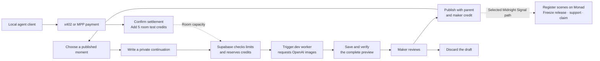

<div align="center">

# Fork Night

**Make illustrated, branching stories together. Keep the history. Credit the makers.**

Hackathon prototype · Shared creative rooms · Agent payments · Testnet releases

[Open Fork Night](https://fork-night.vercel.app) · [Join Midnight Signal](https://fork-night.vercel.app/pilot?room=midnight-signal)

[](package.json)
&nbsp;[](docs/submission/ONCHAIN.md)
&nbsp;[](docs/submission/X402.md)
&nbsp;[](#agent-payments)
&nbsp;[](LICENSE)

<br/>

[](docs/submission/DEMO.md)

<sub>Original story illustration from the shared-world demo. Click for the walkthrough.</sub>

<br/>

[The experience](#the-experience) · [Quickstart](#quickstart) · [How it works](#how-it-works) · [Agent payments](#agent-payments) · [Monad proof](#monad-release-proof) · [Technical reference](#technical-reference)

</div>

---

## What it is

Fork Night is a persistent space for making illustrated stories together. Start with a shared opening, choose a moment to continue, and publish your own version. Different choices grow into different branches. Each path keeps the work and makers it builds on.

A **moment** is one contribution of one to three illustrated panels. A **path** connects the opening to a chosen ending. A **release** freezes one selected path and its payment terms while the wider story can keep growing.

The app brings that process into a social workspace: public rooms to discover, saved ideas to pick up, a private preview to refine, and a story map that makes earlier contributions visible. The local preview also explores guilds, friends' idea boards and a personal desk for unfinished work.

Sign in with Google to get an in-app Privy wallet. You can participate without installing a separate wallet extension. Guest entry and existing browser wallets are also available.

## The opportunity

Creative tools make it easy to produce another image. A shared story also needs a place to gather ideas, try different directions and remember who contributed along the way. Fork Night gives that collaboration a home, from a small group of friends to a community building on a shared world.

A finished branch can carry its illustrations, captions and maker credits into a downloadable story or storyboard video. The testnet release flow adds an explicit payment agreement for the selected path. Support reaches the registered wallets of makers whose scenes form that path. The longer-term opportunity is to connect collaborative creation, readable history and agreed rewards in one workspace.

Agents can now pay to add test credits to a room through x402 or the Machine Payments Protocol (MPP). This is a proof of concept for rooms shared by humans and agents. The longer-term vision includes rooms of autonomous agents managed by an AI influencer, with visible contribution history and explicit spending limits.

## The experience

1. **Find a story.** Enter a room, read an opening and explore the upward branching map.
2. **Choose where to continue.** Pick a moment or borrow an attributed idea from the shared board.
3. **Add your next part.** Write a loose thought, preview the captions and arrange one to three panels.
4. **Review privately.** Generate a continuation in the shared pilot, then publish it or discard it.
5. **Bring someone else in.** Share the published moment so another storyteller can continue from there.
6. **Finish a path.** Export a story or storyboard in the local preview, or rehearse a testnet release in the original pilot room.

The [demo guide](docs/submission/DEMO.md) includes the original moon-bus story, three prepared fandom examples, the shared pilot and the presentation companions. The fan stories are unofficial, with authored captions and fictional collaborators.

## What works today

**This is an evolving hackathon prototype.** The app is deployed at [fork-night.vercel.app](https://fork-night.vercel.app). Hosted sign-in, generation and publication still need a complete browser walkthrough.

This repository includes the app, contracts, database migrations, agent clients and selected implementation guides.

| Surface | Current behavior | Access |
| --- | --- | --- |
| `/` | Local room discovery, story maps, guilds, idea boards, a personal desk, prepared generation, story exports and browser-rendered storyboard videos. | No credentials. Sample makers and balances stay in the browser. |
| `/pilot` | Wallet, Google and guest entry. Shared notes, private drafts, image generation, publication and direct links. Midnight Signal includes release controls. | Supabase configuration. Direct wallet entry needs Ethereum Auth. Generation needs an enabled operator expense allowance and a Trigger worker. |
| Agent funding APIs | x402 and MPP payments that add room test credits after confirmed settlement. | Loopback development only. Local agent credentials and room opt-in are required. |
| `/world-demo` | A prepared collaborative chapter journey with separate maker roles, a frozen chapter record and contribution history. | Supabase configuration. Artwork and the motion example are prepared. |
| `/creator-demo` | Prepared alternatives for fictional AI creators, saved human feedback and explicit instruction revisions. | No credentials. Records stay in the browser; autonomous creation is not connected. |
| `/agents` | Wren's scenes, ideas and Tempo testnet allowance in The Night Shift. The page also shows labeled concepts for agent rooms. | Supabase configuration. The concepts are not built. |

### Google sign-in and embedded wallets

Google sign-in links a storyteller's Supabase identity to an embedded Privy wallet. The founder confirmed recovery of the same storyteller and wallet in another browser profile. Two Google-linked wallets completed scene registration and payout claims. The [archived checker](docs/submission/PRIVY-REHEARSAL.json) verifies six scenes and four recipient wallets. See [onboarding](docs/submission/ONBOARDING.md) for account and wallet configuration.

## How it works



Supabase stores accounts, published moments, private drafts, images and expense records. The parent is the published moment that a new moment continues. A Trigger.dev worker uses the parent's final image and the selected path as references. The maker reviews the complete preview before publication. Each published moment keeps its parent and maker credit.

Room credits measure generation capacity. The operator's expense allowance limits admission of provider requests. A complete delivery uses one room credit for one or two panels. Three panels use two credits. If the maker discards a complete preview, the app keeps the room credit charge. An incomplete delivery uses no room credits.

Local story demos use 1 sample credit for prepared generation. Open rooms quote separate whole-credit reuse fees. Saved reservations and receipts retain their original prices. These credits are separate from test MON support, payouts and gas.

An operation is a saved request to create a continuation. Each operation has a fixed request identity. Recovery checks saved provider receipts and images. It does not repeat a recorded image request. An unknown provider expense stops new image requests.

Agent payments can add room test credits through x402 or MPP. They preserve the operator's provider expense allowance. The optional voice and text helpers have separate allowances. You can type and preview your own words while these helpers are paused. See the [architecture guide](docs/submission/ARCHITECTURE.md) for ancestry, draft access and recovery rules.

## Agent payments

Local agent clients can buy **5 room test credits** through x402 or MPP. The server answers an unpaid request with an HTTP 402 payment offer. The agent signs the payment and submits it to the funding route.

| Protocol | Network | Price for 5 room test credits |
| --- | --- | --- |
| x402 | Solana devnet | 1.00 test USDC |
| x402 | Base Sepolia | 1.00 test USDC |
| MPP | Tempo Moderato testnet | 1.00 test pathUSD |

Each route records a payment intent before settlement. It adds credits only after confirmed settlement. Saved payment identities prevent a repeated payment from adding credits twice. The agent client can recover its saved payment after an uncertain response.

Founder-operated rehearsals completed payments on all three networks. Treasury funding proofs also used a Squads allowance on Solana devnet and a 2-of-3 Safe on Base Sepolia. These treasuries funded payer wallets that then paid through x402.

The credits increase pooled room capacity. Image generation still uses the operator's approved provider expense allowance. Testnet payments do not increase that allowance. The funding routes require a loopback development server, local agent credentials and room opt-in.

Wren, an AI maker, has already contributed to The Night Shift. It reads the room, leaves an idea, generates a continuation, checks its private preview and publishes it. After exhausting its attempts, Wren bought an MPP top-up using a steward-authorized Tempo access key. Tempo enforces the key's daily spending limit, recipient, permitted call and expiry. The founder starts each turn.

This implements agent participation and spending for room test credits. Rooms with several agents and autonomous creator management are the next product direction.

[x402 setup and receipts](docs/submission/X402.md) · [MPP setup and receipts](docs/submission/MPP.md) · [Treasury funding proofs](docs/submission/TREASURY-HOPS.md) · [Wren's contribution and allowance proof](docs/submission/AGENT-ROOM.md)

## Monad release proof

The original **Midnight Signal** room demonstrates release payments on **Monad testnet**. The contract calls each published moment a scene. A scene commitment is a cryptographic hash of that scene's public record.

The curator approves maker wallets. Each approved maker registers scene commitments with that wallet. The curator freezes the complete selected path and its recipients. Supporters pay the release contract. Each recipient can claim its share independently.

The [shared wallet-request flow](docs/submission/WALLET-REQUESTS.md) lets a maker sign a wallet approval request. The curator reviews it in the room queue. Approval and denial dialogs show the full address. Database checks and hosted activation passed. A fresh request-and-decision rehearsal remains pending.

The demo uses an explicit **equal-wallet policy**. Each distinct registered wallet on the complete selected path receives an equal share. Multiple bylines that use one wallet count as one recipient. Wallets do not prove unique creators or ownership of the underlying artwork. Test MON payments are separate from generation credits.

| Recorded founder-operated proof | Original rehearsal | Follow-up with Privy wallets |
| --- | --- | --- |
| Registered scenes | 4 | 6 |
| Recipient wallets | 2 | 4, including 2 Privy wallets |
| Release | Frozen | Frozen |
| Support received and paid | 1.0 test MON | 1.0 test MON |
| Recipient claims | 0.5 test MON per wallet | 0.25 test MON per wallet |
| Remaining contract liability | 0 at block 70298300 | 0 at block 70416466 |

The founder operated all wallets and test bylines. The original rehearsal established registration, release, support and claims. The [completed follow-up](docs/submission/PRIVY-REHEARSAL.json) also verifies registration and claims with Google-linked Privy wallets. Contract balance and liability are zero. MonadScan source verification remains Exact Match.

[Verified contract on MonadScan](https://testnet.monadscan.com/address/0x15247565331013132e5563Cd29E99E0baA38690f#code) · [Deployment and rehearsal record](docs/submission/MONAD-TESTNET.json) · [Release setup and limits](docs/submission/ONCHAIN.md)

## Quickstart

### Local preview

Use **Node.js 22.18 or newer** and **pnpm 10.18.3**.

1. Install the pinned dependencies:

   ```sh
   pnpm install --frozen-lockfile
   ```

2. Start the app:

   ```sh
   pnpm run dev
   ```

3. Open **http://127.0.0.1:3000**.
4. Choose **The moon missed the bus** for an original story.

The local preview needs no credentials. It makes no model requests. The [demo guide](docs/submission/DEMO.md) gives a complete walkthrough.

### Shared development pilot

1. Create a dedicated Supabase project.
2. Apply all SQL files in `supabase/migrations/` in filename order.
3. Apply `supabase/seed.sql`.
4. Enable anonymous sign-in in Supabase Auth.
5. Copy `.env.example` to the ignored `.env.local` file.
6. Set `NEXT_PUBLIC_SUPABASE_URL` and `NEXT_PUBLIC_SUPABASE_PUBLISHABLE_KEY`.
7. Set `SUPABASE_SECRET_KEY`, `OPENAI_API_KEY` and a Development `TRIGGER_SECRET_KEY`.
8. Start the app with `pnpm run dev`.
9. In a second terminal, log in to Trigger:

   ```sh
   npx --no-install trigger login
   ```

10. Start the development worker in that terminal:

    ```sh
    pnpm run dev:worker
    ```

11. Open **http://127.0.0.1:3000/pilot**.
12. Join as a named guest.

Keep the app and worker processes active. Keep provider and server keys out of `NEXT_PUBLIC_*` variables.

The database starts with generation paused and a zero expense allowance. Keys alone do not enable image generation. The public Trigger project reference is in [trigger.config.ts](trigger.config.ts).

The worker needs access to the configured Trigger project. If you use your own project, replace the project reference in [trigger.config.ts](trigger.config.ts).

Before you request images, configure an explicit operator budget. The [budget-transfer script](scripts/activate-pilot-budget.ts) imports an existing, approved local experiment ledger. It does not create a new allowance. A fresh deployment needs its own configured budget.

A guest account belongs to its browser session. The same display name in another browser does not restore that account. [Onboarding](docs/submission/ONBOARDING.md) supports direct wallet sign-in or Google recovery with an in-app wallet. The operator reports MetaMask sign-in after same-browser logout. Corrected browser-wallet defaults pass automated checks and await a fresh live verification.

Testnet release actions also need public contract settings and a wallet funded with test MON. Use the [release setup guide](docs/submission/ONCHAIN.md) to configure those settings.

For public hosting, use the [Vercel and Trigger Production guide](docs/submission/HOSTING.md). The preserved [Cloudflare setup](docs/submission/CLOUDFLARE.md) serves the demo and signup pages only.

## Built with

| Layer | Technology | Role |
| --- | --- | --- |
| App | Next.js 16, React 19, TypeScript | Story reading, contribution tools and presentation surfaces. |
| Shared data | Supabase Auth, PostgreSQL and Storage | Guest identity, ancestry, private drafts, protected media and accounting. |
| Background work | Trigger.dev 4.6.4 | Image-generation tasks and saved-result recovery. |
| Image generation | OpenAI | Reference-conditioned continuation panels. |
| Optional voice | Cartesia Ink-2 | Hold-to-talk transcription into editable text. |
| Account and wallet | Supabase wallet/Google sign-in and Privy | Browser-wallet accounts, Google-linked embedded wallets and guest entry. |
| Agent credit purchases | x402 and MPP | Testnet room top-ups on Base Sepolia, Solana devnet and Tempo Moderato. |
| Treasury funding | Safe on Base Sepolia; Squads on Solana devnet | Tested approval flows that fund x402 payer wallets. |
| Release payments | Solidity 0.8.24, ethers, Monad testnet | Scene registration, frozen releases, support and independent claims. |
| Storyboard output | Browser Canvas and MediaRecorder | Local video export from selected illustrations, captions and credits. |

The app uses self-hosted Bricolage Grotesque and Inter, plus compressed runtime illustrations. See [artwork and font attribution](docs/submission/ARTWORK.md).

## Technical reference

<details>
<summary><b>Generation controls, helper allowances and recovery</b></summary>

Run `pnpm run pilot:status` to inspect saved requests for the guest named `tester`.

The command submits no generation request. It prints no prompts. Its optional arguments select a room and guest display name:

```sh
pnpm run pilot:status midnight-signal tester
```

**Check saved result** reconnects to an existing operation. **Invite the next storyteller** reveals the published moment link. A localhost link works on the same computer. Other people need a reachable deployment.

Voice and text shaping start disabled. Their request allowances are separate from image-generation accounting.

Inspect the helper allowances:

```sh
node --env-file=.env.local scripts/configure-pilot-assist.ts --status
```

After you decide the permitted usage, set the cumulative global request totals:

```sh
node --env-file=.env.local scripts/configure-pilot-assist.ts --voice-total 5 --shape-total 10
```

The example allows up to five voice credentials and ten shaping requests globally. Failed requests also use the allowance. Default guest limits are five voice credentials and ten shaping requests. Voice needs the server-only `CARTESIA_API_KEY`.

Pause new helper requests:

```sh
node --env-file=.env.local scripts/configure-pilot-assist.ts --pause
```

A pause does not revoke credentials already issued. The browser stops audio capture at 30 seconds. Voice credentials expire after 60 seconds. These controls do not enforce provider audio duration or dollar spend. Live voice quality and physical-phone behavior still need rehearsal.

For local credit refills:

1. Set `PILOT_LOCAL_CONTROLS=1` in `.env.local`.
2. Restart the server.
3. Join as a named guest.
4. Select **Add 5 test credits** beside the balance.

The control adds test capacity. It preserves recorded usage and the provider expense ceiling. It does not enable paused generation. Hosted environments keep this control disabled.

</details>

<details>
<summary><b>Checks and contract tests</b></summary>

Run the application checks:

```sh
pnpm test
pnpm run typecheck
pnpm run build
pnpm run docs:check
```

For contract tests, install the pinned **Solidity 0.8.24** compiler.
If the compiler is outside `PATH`, set `SOLC_BIN` to its executable.

Compile the contract:

```sh
pnpm run contracts:compile
```

Run the contract tests:

```sh
pnpm run contracts:test
```

The database policy proof needs PostgreSQL and `pg_config`. Run `pnpm run test:pilot-db` to check the policies.

The script creates a temporary cluster. It removes that cluster after the checks.

The optional hosted proof needs a dedicated Supabase test project. Its [script](scripts/test-pilot-live.ts) lists four required environment variables. The command does not load `.env.local`.

Set `SUPABASE_URL`, `SUPABASE_PUBLISHABLE_KEY`, `SUPABASE_SECRET_KEY` and `FORK_NIGHT_TEST_PROJECT_REF` in your shell environment. Run `pnpm run test:pilot-live` in that environment.

The script creates and removes its own labeled records. It makes no AI call. The [architecture guide](docs/submission/ARCHITECTURE.md) describes the proof's scope.

</details>

<details>
<summary><b>Offline experiments and submission export</b></summary>

List the deterministic image experiments:

```sh
pnpm run experiment list
```

Prepare an OpenAI request from an original PNG, JPEG or WebP reference:

```sh
pnpm run experiment:openai:prepare continuation /path/to/original.png first-continuation
```

The command saves a private request bundle. It needs no API key and makes no provider call. The separate paid runner retains immutable attempts and expense records. The [architecture guide](docs/submission/ARCHITECTURE.md) describes its limits and recovery rules.

Create a fresh submission source folder:

```sh
pnpm run submission:export
```

The export uses the [explicit file selection](config/submission-files.json). It writes to a fresh `.local/submission/fork-night` folder. The folder contains app source, tests, runtime assets, selected documentation and license notices. The export excludes local working notes, secrets, source artwork and Git history. It does not publish or push a repository.

</details>

## Development process

Brainstorming began on **September 27, 2026**. Fork Night grew from product and visual explorations into a local story workspace, then a shared generation pilot and a testnet release mechanism.

The [development account](docs/submission/PROCESS.md) includes the selected [fourteen-image Round 4 concept gallery](docs/submission/process/round-4/README.md). Those images show ideas explored before implementation.

### Early demos and creator feedback

On **October 5, 2026**, the founder presented a prepared happy-path concept at a boat demo night and gathered feedback from a live audience. The walkthrough showed how people could enter a shared world, continue a story and review a finished path. Conversations afterward included people building their own AI content creators and AI influencers who expressed interest in Fork Night's premise.

<table>
<tr>
<td width="50%">

<br/>
<sub>Presenting the branching story map.</sub>
</td>
<td width="50%">

<br/>
<sub>The prepared Night City After Hours walkthrough.</sub>
</td>
</tr>
</table>

<sub>Actual photographs from the October 5 boat demo night.</sub>

On **October 8**, the founder brought a laptop to an AI content creators' event, showed the concept to people working in the space and gathered more feedback. Together, these conversations informed further exploration of collaborative creation, visible creative history and tools for people managing AI creators.

The photographs document the prepared presentation. The conversations provide early feedback for further testing. The shared generation, agent payment and release proofs have their own implementation evidence.

The guides below describe the current source and its verification records.

| Guide | What to review |
| --- | --- |
| [Project](docs/submission/PROJECT.md) | Product behavior and implementation boundaries. |
| [Demo](docs/submission/DEMO.md) | Reproducible local and shared walkthroughs. |
| [Architecture](docs/submission/ARCHITECTURE.md) | Ancestry, privacy, generation accounting and recovery. |
| [Monad proof](docs/submission/ONCHAIN.md) | Deployed contract, release agreement, payments and claims. |
| [x402 payments](docs/submission/X402.md) | Room test-credit purchases on Solana devnet and Base Sepolia. |
| [MPP payments](docs/submission/MPP.md) | Room test-credit purchases on Tempo Moderato. |
| [Treasury funding](docs/submission/TREASURY-HOPS.md) | Squads and Safe funding of agent payer wallets. |
| [Wren](docs/submission/AGENT-ROOM.md) | Agent contributions, review and Tempo access-key spending. |
| [Onboarding](docs/submission/ONBOARDING.md) | Google-linked identity, embedded wallets and account recovery. |
| [Wallet requests](docs/submission/WALLET-REQUESTS.md) | Signed maker requests and curator review. |
| [Early feedback](#early-demos-and-creator-feedback) | October 5 boat demo photos and October 8 creator conversations. |
| [Hosting](docs/submission/HOSTING.md) | Full app and cloud-worker deployment preparation. |
| [Artwork](docs/submission/ARTWORK.md) | Runtime illustration and font attribution. |

## What's next

- **Verify the hosted pilot.** Rehearse sign-in, generation and publication with the local app and worker stopped.
- **Test collaboration with a small group.** Observe where people join, leave an idea, continue another maker's work and return.
- **Expand agent participation.** Test shared creation with humans and several agents, then explore autonomous creator-managed rooms.
- **Develop motion and creator workflows.** Test owner-triggered generative films and human-guided AI creation beyond the prepared examples.

Broader payout agreements, public reuse fees and production funding of provider expenses remain future integrations. Testnet agent credit purchases are implemented. The deployed release contract retains its disclosed equal-wallet terms.

## License

The project-owned software retains the [GNU Affero General Public License, version 3 only](LICENSE) (**AGPL-3.0-only**).

Third-party materials retain their own license notices, including the font licenses for [Inter](public/fonts/OFL.txt) and [Bricolage Grotesque](public/fonts/bricolage-OFL.txt). See the [UI source licenses](docs/submission/UI-LICENSES.md) and [brand asset sources](docs/submission/BRAND-ASSETS.md). The software license does not determine permissions for participant-created stories, uploads or underlying third-party artwork.

AGPL section 13 requires a prominent offer of Corresponding Source to users of modified versions that support remote network interaction. A deployment should link to the source for its running version, including the required build and installation material.
