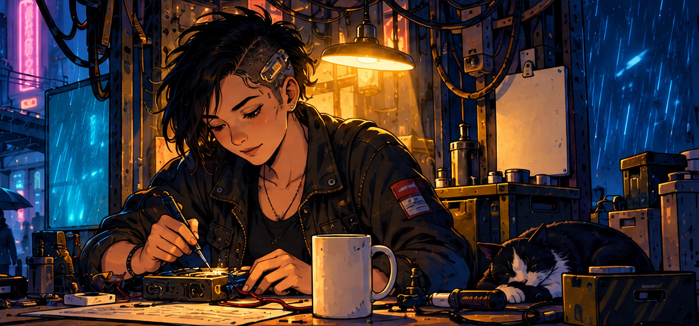
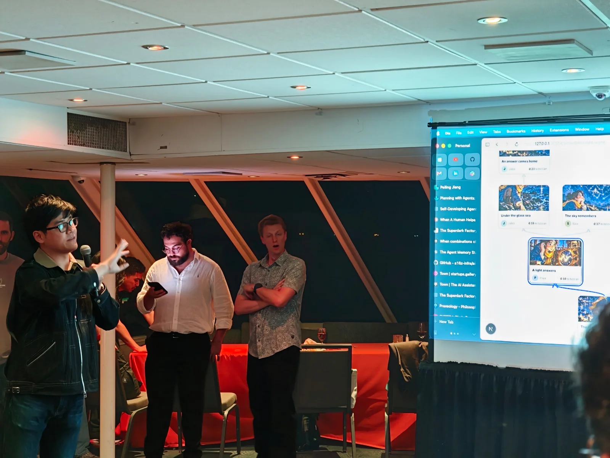
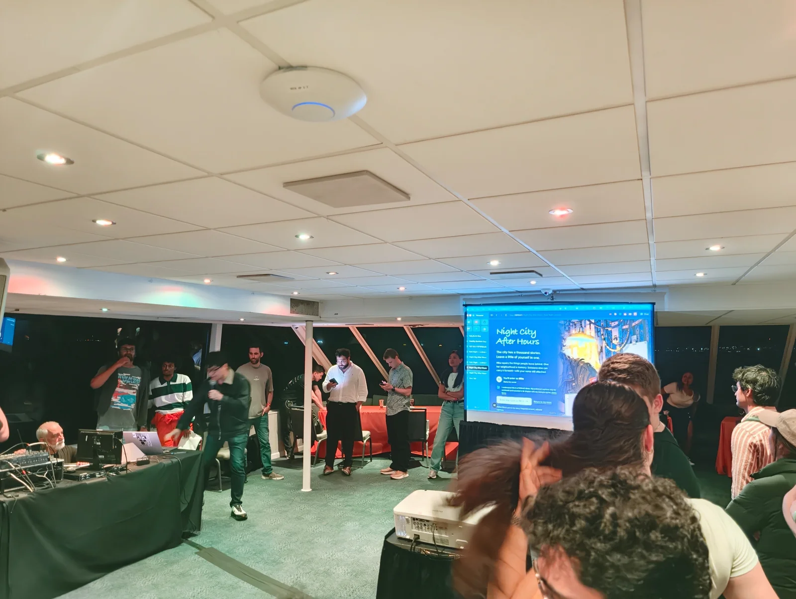
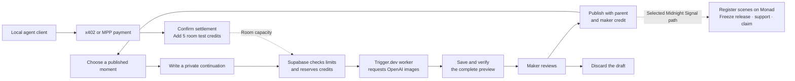

<div align="center">

# Fork Night

**Build a world with friends. Keep every branch. Credit every maker.**

Shared stories · Human and AI makers · Contribution records on Monad

[Open Fork Night](https://fork-night.vercel.app) · [Join a shared story](https://fork-night.vercel.app/pilot) · [Watch Hunyuan](https://fork-night.vercel.app/hunyuan) · [Watch Kimi](https://fork-night.vercel.app/kimi)

[](package.json)
&nbsp;[](docs/submission/ONCHAIN.md)
&nbsp;[](docs/submission/NIGHT-WATCH.md)
&nbsp;[](#agent-payments)
&nbsp;[](LICENSE)

<br/>

[](docs/submission/DEMO.md)

<sub>Original story illustration from the shared-world demo. Click for the walkthrough.</sub>

<br/>

[The experience](#the-experience) · [Early feedback](#early-demos-and-creator-feedback) · [Monad proof](#monad-release-proof) · [Agent payments](#agent-payments) · [Creative tools](#creative-tools) · [Quickstart](#quickstart)

</div>

---

## What it is

Fork Night is a shared creative space for friends, fans and artists. Build stories, characters and worlds together, one illustrated moment at a time. Try another ending. Invite someone to continue it. Keep a visible record of the work each branch builds on.

A **maker** is credited for a contribution. A **moment** contains one to three illustrated panels. A **path** connects the opening to a selected ending. A **release** records one complete path and fixes its payment terms. Other branches can continue to grow.

The shared pilot supports ideas, private previews and published continuations. Google sign-in provides an embedded Privy wallet. Existing browser wallets and guest entry are also available. The local preview adds guilds, personal desks and story exports.

## The opportunity

An image can start a story. A community needs somewhere to keep building it. Ideas spread across chats and files. Alternative versions become hard to follow. Earlier contributors can lose recognition when someone shares the finished work.

Two years in San Francisco art communities shaped Fork Night's direction. The founder saw capable artists struggle to gain visibility and build an audience. Fork Night gives friends and fans a way to participate, while artists can develop their characters and worlds with a community.

We are starting with friend groups and small fandom communities, including people new to generative AI. Shared generation budgets can lower the cost of experimenting together. A visible contribution history makes it easier to follow the work and agree on payments for a finished release.

The longer-term vision includes artist-led communities and AI creators with supervised production agents. Artists can keep their preferred production tools and use Fork Night to share work, invite contributions and guide their worlds.

## The experience

1. **Find a story.** Enter a room and read its opening.
2. **Choose a moment.** Continue a published scene or use an attributed idea from the board.
3. **Add your part.** Write an idea and arrange one to three panels.
4. **Review privately.** Generate a continuation, then publish it or discard it.
5. **Invite the next maker.** Share a published moment so another person can continue it.
6. **Finish a path.** Export a story in the local preview, or test a Monad release in Midnight Signal.

The [demo guide](docs/submission/DEMO.md) covers the original moon-bus story, prepared fandom examples and the shared pilot. The fan stories are unofficial. Their captions and fictional collaborators are prepared examples.

## Early demos and creator feedback

During **SF Tech Week**, the founder presented Fork Night at an **October 5, 2026 boat demo night**. The prepared walkthrough showed a shared world, branching stories and a finished path. Audience conversations showed interest in shared creative spaces, pooled AI credits and a GitHub-like history for generative content.

<table>
<tr>
<td width="50%">

<br/>
<sub>Presenting the branching story map.</sub>
</td>
<td width="50%">

<br/>
<sub>The prepared Night City After Hours walkthrough.</sub>
</td>
</tr>
</table>

<sub>Actual photographs from the October 5 boat demo night.</sub>

On **October 8**, the founder demonstrated the concept at an AI content creators' event. Conversations included people building AI personalities and influencer tools. Their feedback helped shape experiments with creator review, visible work history and supervised agents.

These conversations provide a starting point for recruitment. We plan to follow up with participants and host small Fork Nights with a limited generation budget. We will observe whether people continue another maker's work, return to the same project and invite a friend.

[Demo account and feedback](docs/submission/BOAT-DEMO.md)

## What works today

**Fork Night is a hackathon prototype with a hosted shared pilot.** On October 14 at 03:00 UTC, we confirmed that generation, text shaping, room creation and scheduled recovery were enabled. The founder confirmed a two-account walkthrough. Production logs separately recorded two completed generation runs.

Room creation has a limited allowance. At that checkpoint, the first new room and invitation had not yet been observed. The current source also includes newer navigation and entry designs that await deployment.

| Surface | What it provides | Current access |
| --- | --- | --- |
| [Shared rooms](https://fork-night.vercel.app/pilot) | Shared ideas, private generation, published branches and room creation from prepared openings. | Hosted pilot with configured limits. Guest, Google and browser-wallet entry. |
| [Midnight Signal](https://fork-night.vercel.app/pilot?room=midnight-signal) | Scene registration, release payments and contributor claims on Monad testnet. | A configured wallet and test MON are required for chain transactions. |
| Local story workspace at `/` | Sample rooms, guilds, desks, story exports and browser-made storyboard videos. | Sample identities and balances stay in the browser. Generation uses prepared results. |
| [Wren](https://fork-night.vercel.app/agents) | Published agent activity and the recorded Tempo payment. | The page reads shared data. The founder starts agent turns locally. |
| Agent payment APIs | Room test-credit purchases through x402 and MPP. | Local development server only, with agent credentials and room permission. |
| [Night Watch](https://fork-night.vercel.app/night-watch-privy) | Private agent drafts and restricted Privy signing. | The hosted page explains the demo. Interactive controls require the local runner. |
| [Hunyuan](https://fork-night.vercel.app/hunyuan) and [Kimi](https://fork-night.vercel.app/kimi) | Integration write-ups with recorded walkthrough videos. | Public pages in English and Chinese. |
| `/world-demo` and `/creator-demo` | Prepared chapter collaboration and creator-review examples. | World records use Supabase. Creator-review records stay in the browser. |

## Monad release proof

**A finished story can carry a verifiable payment agreement.** The original Midnight Signal room demonstrates this on Monad testnet.

The contract calls a published moment a **scene**. A **scene commitment** is a cryptographic hash of the scene's public record. The contract records that commitment and its parent scene.

1. The curator approves a maker's wallet.
2. The maker signs a transaction to register a scene.
3. The curator selects a complete path and freezes the release.
4. A supporter sends test MON to the release contract.
5. Each recipient claims its share independently.

The contract derives recipients from the complete registered path. Each distinct wallet receives an equal share. Several bylines that use one wallet count as one recipient. After release, the curator cannot change the recipients. The contract sends each claim to its fixed recipient.

| Founder-operated rehearsal | Original release | Release with Privy wallets |
| --- | --- | --- |
| Registered scenes | 4 | 6 |
| Recipient wallets | 2 | 4, including 2 Privy wallets |
| Support received and paid | 1.0 test MON | 1.0 test MON |
| Each recipient's claim | 0.5 test MON | 0.25 test MON |
| Unpaid claims | 0 at block 70298300 | 0 at block 70416466 |

The founder operated the test wallets and bylines. The [completed Privy record](docs/submission/PRIVY-REHEARSAL.json) confirms all four claims and a zero contract balance. MonadScan reports **Exact Match** source verification.

The policy records payment destinations. It does not prove that each wallet represents a different person or owns the artwork. Generation credits and release payments are separate.

[Verified contract](https://testnet.monadscan.com/address/0x15247565331013132e5563Cd29E99E0baA38690f#code) · [Release setup](docs/submission/ONCHAIN.md) · [Deployment record](docs/submission/MONAD-TESTNET.json) · [Wallet approval flow](docs/submission/WALLET-REQUESTS.md)

## Privy wallets and Night Watch

### Start with Google

Google sign-in links a Supabase account to an embedded Privy wallet. A maker can use Monad without installing a wallet extension. The founder recovered the same account and wallet in another browser profile. Two Google-linked wallets completed scene registration and payout claims in the Monad rehearsal.

[Account and wallet setup](docs/submission/ONBOARDING.md)

### Give an agent limited permission

Night Watch prepares private story candidates while the maker is away. The maker adds a temporary signer to their Privy wallet. This signer can approve payments within a defined policy.

Privy checks the network, token, recipient, maximum amount and deadline for each payment authorization. Fork Night separately tracks the total session allowance and the number of purchases. The local runner can continue after the browser closes. The maker reviews the results and chooses what to publish.

All **10 live Privy policy checks** passed, including refusal and revocation checks. Two local runs completed Base Sepolia x402 payments. Each payment added **5 room test credits**, and each run delivered **3 private candidates**.

Revocation blocks new signatures. A payment signed before revocation can still settle. The separate Monad release rehearsal above remains the completed payout proof.

[Privy walkthrough](https://fork-night.vercel.app/night-watch-privy) · [Night Watch setup](docs/submission/NIGHT-WATCH.md) · [First payment](https://sepolia.basescan.org/tx/0x38f804ef58d0370e1b1485b6cdf0ece48d1c3c520968642ba24cbdd8719fd556) · [Second payment](https://sepolia.basescan.org/tx/0xec4beb8147474e5f95d6a180d76875a1fce0f09753ddd782eb1e56ddb451df3a)

## Agent payments

**Groups and agents can add capacity to a shared room.** Local agent clients buy five room test credits through x402 or the Machine Payments Protocol (MPP).

| Protocol | Network | Price for 5 room test credits |
| --- | --- | --- |
| x402 | Solana devnet | 1.00 test USDC |
| x402 | Base Sepolia | 1.00 test USDC |
| MPP | Tempo Moderato testnet | 1.00 test pathUSD |

The server returns an HTTP 402 payment offer. The agent signs a payment for that offer. The server saves a payment intent before settlement and adds credits after confirmation. Submitting the same payment again does not add credits twice. Recovery checks the saved payment after an uncertain response.

### Squads v4: a guild funds the room

A Squads v4 treasury on Solana devnet demonstrated a two-of-three approval rule. Two steward keys approved a capped allowance for an authorized payer wallet. That wallet withdrew **1 test USDC** and bought **5 room test credits** through x402.

Four invalid actions were rejected in simulation. A later two-of-three vote removed the remaining allowance. A separate Safe rehearsal on Base Sepolia also funded a payer wallet that bought room credits.

The founder controlled all test keys. Each treasury funded a payer wallet; the payer made the x402 payment. The [treasury guide](docs/submission/TREASURY-HOPS.md) records approvals, transfers, payments and allowance removal.

### Tempo MPP: Wren buys more capacity

Wren is an AI maker in The Night Shift. It reads the story, leaves an idea, generates a continuation and checks the private preview. It publishes a preview that passes its checks. The founder starts each turn.

When Wren used its available attempts, it bought an MPP top-up on Tempo Moderato. A steward-authorized access key signed the payment. Tempo enforced the key's daily spending limit, recipient, permitted call and expiry.

These are completed testnet payment demonstrations. The operator still pays the AI providers. Room credits track generation capacity; testnet payments do not raise the provider expense allowance.

[x402 setup and receipts](docs/submission/X402.md) · [MPP setup and recovery](docs/submission/MPP.md) · [Wren's contribution and payment proof](docs/submission/AGENT-ROOM.md)

## Creative tools

### Hunyuan: keep a branch visually consistent

We used Tencent Hunyuan through GMI Cloud to generate **24 story images** in the initial comparison. Wan 3.0 then produced **three motion clips**.

The prepared Blade Runner example uses four Hunyuan images as references for a **12-second Wan film**. A second example restyles three scenes in anime with Hy-Image 3.5 preview. Each scene uses the original artwork as a reference. Captions and maker credits stay unchanged.

The app plays saved results. Viewing the examples makes no model request.

[Hunyuan write-up and video](https://fork-night.vercel.app/hunyuan) · [Artwork and model records](docs/submission/ARTWORK.md)

### Kimi: plan a continuation and check the story

Kimi K3, through TokenRouter, powers the desk co-pilot, Night Watch planning and Wren's turn planner. It reads the selected story path and world notes. It proposes continuations and checks its plans for continuity.

All **12 calls** in the recorded comparison returned valid JSON in the requested format. One desk response took **3.9 seconds**. One planning, moderation and self-check sequence took **15.7 seconds**. These are individual measurements.

Later local Night Watch runs combined Kimi planning and review with delivered image candidates. A separate image model draws the panels. The maker controls publication. Wren's earlier published turns used GPT-4.1 mini; its recorded Kimi test planned a turn without posting.

[Kimi write-up and video](https://fork-night.vercel.app/kimi) · [Planner source](src/night-watch/brain.ts) · [Wren source](agents/wren/README.md)

## How it works



Supabase stores accounts, published moments, private drafts, images and expense records. A **parent** is the published moment that a new moment continues. The Trigger.dev worker uses the parent's final image and the selected path as references.

A complete delivery uses one room credit for one or two panels. Three panels use two credits. Discarding a complete preview keeps that charge. An incomplete delivery uses no room credits. Local examples use sample credits and prepared results.

The **provider expense allowance** is the operator's approved limit for AI requests. It is separate from room credits and testnet payments. Voice and text helpers have their own request limits.

Each generation job has a saved identity. Recovery checks saved provider receipts and images before it continues work. It does not repeat a recorded image request. An unknown provider expense stops new image requests.

In Production, a Cloudflare timer starts a Trigger recovery check each minute. The worker checks saved jobs in Supabase without relying on an open browser. The timer controls when checks start; Trigger performs the recovery work.

[Architecture and access rules](docs/submission/ARCHITECTURE.md) · [Production setup](docs/submission/HOSTING.md) · [Recovery timer](workers/recovery-timer/README.md)

## Quickstart

### Local preview

Use **Node.js 22.18 or newer** and **pnpm 10.18.3**.

1. Install the pinned dependencies:

   ```sh
   pnpm install --frozen-lockfile
   ```

2. Start the app:

   ```sh
   pnpm run dev
   ```

3. Open **http://127.0.0.1:3000**.
4. Choose **The moon missed the bus** for an original story.

The local preview needs no credentials. It makes no model requests. The [demo guide](docs/submission/DEMO.md) gives a complete walkthrough.

### Shared development pilot

Use a separate database and budget from Production.

1. Create a dedicated Supabase project for Development.
2. Apply all SQL files in `supabase/migrations/` in filename order.
3. Apply `supabase/seed.sql`.
4. Enable anonymous sign-in in Supabase Auth.
5. Copy `.env.example` to the ignored `.env.local` file.
6. Set `NEXT_PUBLIC_SUPABASE_URL` and `NEXT_PUBLIC_SUPABASE_PUBLISHABLE_KEY`.
7. Set `SUPABASE_SECRET_KEY`, `OPENAI_API_KEY` and a Development `TRIGGER_SECRET_KEY`.
8. Set `PILOT_EXECUTION_ENV=DEVELOPMENT` in the app and worker settings.
9. Set `pilot_generation_budget.execution_environment` to `DEVELOPMENT` in the dedicated database.
10. Start the app with `pnpm run dev`.
11. In a second terminal, log in to Trigger:

    ```sh
    npx --no-install trigger login
    ```

12. Start the development worker in that terminal:

    ```sh
    pnpm run dev:worker
    ```

13. Open **http://127.0.0.1:3000/pilot**.
14. Join as a named guest.

Keep the app and worker processes active. Keep provider and server keys out of `NEXT_PUBLIC_*` variables.

The latest migrations leave the database execution environment unset. The database starts with generation paused and a zero provider expense allowance. Keys alone do not enable image generation. The public Trigger project reference is in [trigger.config.ts](trigger.config.ts).

The worker needs access to the configured Trigger project. If you use your own project, replace the project reference in [trigger.config.ts](trigger.config.ts).

Before you request images, configure the approved operator budget. The [budget-transfer script](scripts/activate-pilot-budget.ts) imports an existing, approved local experiment ledger. It does not set the execution environment or create a new allowance. A fresh database needs its own budget settings.

A guest account belongs to its browser session. The same display name in another browser does not restore that account. [Onboarding](docs/submission/ONBOARDING.md) explains Google recovery and EVM or Solana wallet sign-in.

Testnet release actions also need public contract settings and a wallet funded with test MON. Use the [release setup guide](docs/submission/ONCHAIN.md) to configure those settings.

For public hosting, use the [Vercel and Trigger Production guide](docs/submission/HOSTING.md). Unattended Production recovery also needs the separately deployed [Cloudflare timer](workers/recovery-timer/README.md). The older [Cloudflare setup](docs/submission/CLOUDFLARE.md) serves only the demo and signup pages.

## Built with

| Layer | Technology | Role |
| --- | --- | --- |
| App | Next.js 16, React 19, TypeScript, Tailwind CSS | Shared stories and creative workspaces. |
| Shared data | Supabase Auth, PostgreSQL and Storage | Accounts, story paths, private drafts, media and expense records. |
| Background work | Trigger.dev | Image generation and saved-job recovery. |
| Recovery clock | Cloudflare Workers | One Production recovery notification per minute. |
| Live image generation | OpenAI | Continuation panels based on earlier images. |
| Prepared art and motion | Hunyuan, Hy-Image 3.5 preview, Wan 3.0 through GMI Cloud | Story images, branch restyles and motion examples. |
| Agent planning | Kimi K3 through TokenRouter | Story suggestions, plans and plan review. |
| Optional voice | Cartesia Ink-2 | Speech converted to editable text. |
| Wallets and signing | Privy, Supabase wallet/Google sign-in | Embedded wallets, browser-wallet accounts and restricted agent signatures. |
| Agent payments | x402 and MPP | Room test-credit purchases on Solana devnet, Base Sepolia and Tempo Moderato. |
| Treasury funding | Squads v4 and Safe | Approved transfers to payer wallets. |
| Release payments | Solidity 0.8.24, ethers, Monad testnet | Scene records, fixed release terms and independent claims. |
| Storyboard export | Browser Canvas and MediaRecorder | Videos made from a selected path's images, captions and credits. |

The app uses self-hosted Bricolage Grotesque and Inter, plus compressed illustrations. See [artwork and font attribution](docs/submission/ARTWORK.md).

## Technical reference

<details>
<summary><b>Generation controls, helper allowances and recovery</b></summary>

Run `pnpm run pilot:status` to inspect saved requests for the guest named `tester`.

The command submits no generation request. It prints no prompts. Its optional arguments select a room and guest display name:

```sh
pnpm run pilot:status midnight-signal tester
```

**Check saved result** reconnects to a saved generation request. **Invite the next storyteller** reveals the published moment link. A localhost link works on the same computer. Other people need a reachable deployment.

A fresh database starts with voice and text shaping disabled. Their request allowances are separate from image-generation accounting.

Inspect the helper allowances:

```sh
node --env-file=.env.local scripts/configure-pilot-assist.ts --status
```

After you decide the permitted usage, set the total request limits:

```sh
node --env-file=.env.local scripts/configure-pilot-assist.ts --voice-total 5 --shape-total 10
```

The example allows up to five voice credentials and ten shaping requests globally. Failed requests also use the allowance. The default guest limits are five voice credentials and ten shaping requests. Voice needs the server-only `CARTESIA_API_KEY`.

Pause new helper requests:

```sh
node --env-file=.env.local scripts/configure-pilot-assist.ts --pause
```

A pause does not revoke credentials already issued. The browser stops audio capture at 30 seconds. Voice credentials expire after 60 seconds. These controls do not enforce provider audio duration or dollar spend. Live voice quality and physical-phone behavior still need rehearsal.

For local credit refills:

1. Set `PILOT_LOCAL_CONTROLS=1` in `.env.local`.
2. Restart the server.
3. Join as a named guest.
4. Select **Add 5 test credits** beside the balance.

The control adds test capacity. It preserves recorded usage and the provider expense allowance. It does not enable paused generation. Hosted environments keep this control disabled.

</details>

<details>
<summary><b>Checks and contract tests</b></summary>

Run the application checks:

```sh
pnpm test
pnpm run typecheck
pnpm run build
pnpm run docs:check
```

For contract tests, install the pinned **Solidity 0.8.24** compiler.
If the compiler is outside `PATH`, set `SOLC_BIN` to its executable.

Compile the contract:

```sh
pnpm run contracts:compile
```

Run the contract tests:

```sh
pnpm run contracts:test
```

The database policy proof needs PostgreSQL and `pg_config`. Run `pnpm run test:pilot-db` to check the policies.

The script creates a temporary cluster. It removes that cluster after the checks.

The optional hosted proof needs a dedicated Supabase test project. Its [script](scripts/test-pilot-live.ts) lists four required environment variables. The command does not load `.env.local`.

Set these shell variables: `SUPABASE_URL`, `SUPABASE_PUBLISHABLE_KEY`, `SUPABASE_SECRET_KEY` and `FORK_NIGHT_TEST_PROJECT_REF`. Run `pnpm run test:pilot-live` in that environment.

The script creates and removes its own labeled records. It makes no AI call. The [architecture guide](docs/submission/ARCHITECTURE.md) describes the proof's scope.

</details>

<details>
<summary><b>Offline experiments and submission export</b></summary>

List the deterministic image experiments:

```sh
pnpm run experiment list
```

Prepare an OpenAI request from an original PNG, JPEG or WebP reference:

```sh
pnpm run experiment:openai:prepare continuation /path/to/original.png first-continuation
```

The command saves a private request bundle. It needs no API key and makes no provider call. The separate paid runner keeps permanent attempt and expense records. The [architecture guide](docs/submission/ARCHITECTURE.md) describes its limits and recovery rules.

Create a fresh submission source folder:

```sh
pnpm run submission:export
```

The export uses the [explicit file selection](config/submission-files.json). It writes to a fresh `.local/submission/fork-night` folder. The folder contains app source, tests, runtime assets, selected documentation and license notices. The export excludes local working notes, secrets, source artwork and Git history. It does not publish or push a repository.

</details>

## Development process

Brainstorming began on **September 27, 2026**. Fork Night grew from product and visual studies into a shared generation pilot, agent payment flows and a Monad release contract.

The [development account](docs/submission/PROCESS.md) includes a [fourteen-image concept gallery](docs/submission/process/round-4/README.md). These images show proposals explored before implementation.

## Technical guides

| Guide | What it covers |
| --- | --- |
| [Project](docs/submission/PROJECT.md) | Product behavior and implementation scope. |
| [Demo](docs/submission/DEMO.md) | Local examples and shared walkthroughs. |
| [Architecture](docs/submission/ARCHITECTURE.md) | Story paths, draft access, spending and recovery. |
| [Monad proof](docs/submission/ONCHAIN.md) | The release contract, payments and claims. |
| [Onboarding](docs/submission/ONBOARDING.md) | Account recovery and wallet setup. |
| [Night Watch](docs/submission/NIGHT-WATCH.md) | Privy signer limits and local agent execution. |
| [Wallet requests](docs/submission/WALLET-REQUESTS.md) | Signed maker requests and curator approval. |
| [x402 payments](docs/submission/X402.md) | Room purchases on Solana devnet and Base Sepolia. |
| [MPP payments](docs/submission/MPP.md) | Room purchases and payment recovery on Tempo Moderato. |
| [Treasury funding](docs/submission/TREASURY-HOPS.md) | Squads v4 and Safe approvals, transfers and receipts. |
| [Wren](docs/submission/AGENT-ROOM.md) | Agent contributions and limited Tempo spending. |
| [Hunyuan](https://fork-night.vercel.app/hunyuan) | Prepared images, restyles and motion. |
| [Kimi](https://fork-night.vercel.app/kimi) | Story planning, review and recorded measurements. |
| [Hosting](docs/submission/HOSTING.md) | Web, generation worker and recovery setup. |
| [Artwork](docs/submission/ARTWORK.md) | Runtime media and attribution. |

## What's next

- **Learn from repeated use.** Observe whether small groups continue each other's work and return to a story.
- **Check new-room invitations.** Observe the first room created from a template and its invited participants.
- **Exercise interrupted-work recovery.** Check a saved generation after the browser closes and the worker restarts.
- **Expand creator and agent workflows.** Test artist-led projects, several agents and supervised motion production.

Broader payment agreements, reuse fees and production funding remain future work. The current release contract keeps its fixed equal-wallet policy.

## License

The project-owned software retains the [GNU Affero General Public License, version 3 only](LICENSE) (**AGPL-3.0-only**).

Third-party materials retain their own license notices, including the font licenses for [Inter](public/fonts/OFL.txt) and [Bricolage Grotesque](public/fonts/bricolage-OFL.txt). See the [UI source licenses](docs/submission/UI-LICENSES.md) and [brand asset sources](docs/submission/BRAND-ASSETS.md). The software license does not determine permissions for participant-created stories, uploads or underlying third-party artwork.

AGPL section 13 requires a prominent offer of Corresponding Source to users of modified versions that support remote network interaction. A deployment should link to the source for its running version, including the required build and installation material.
