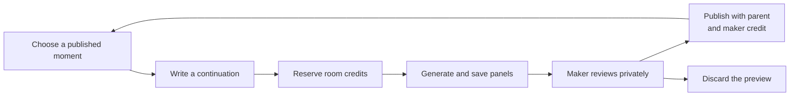

<div align="center">

# Fork Night

**Build a world with friends. Keep every branch. Credit every maker.**

A shared story workspace for friends, fans and artists.

[Start in Kessler Ward](https://fork-night.vercel.app/pilot?room=kessler-ward) · [Explore Fork Night](https://fork-night.vercel.app) · [Watch Hunyuan](https://fork-night.vercel.app/hunyuan) · [Watch Kimi](https://fork-night.vercel.app/kimi)

[](package.json)
&nbsp;[](docs/submission/ONCHAIN.md)
&nbsp;[](docs/submission/NIGHT-WATCH.md)
&nbsp;[](#agent-payments)
&nbsp;[](LICENSE)

<br/>

[](docs/submission/DEMO.md)

<sub>Original artwork from the shared-world demo. Click for the walkthrough.</sub>

<br/>

[The experience](#the-experience) · [Try the prototype](#what-works-today) · [How it works](#how-it-works) · [Monad proof](#monad-release-proof) · [AI collaborators](#ai-collaborators) · [Quickstart](#quickstart)

</div>

---

## What it is

Fork Night is a place to make illustrated stories together. Read a beginning, add your own scene, and invite someone else to take it further. Every published continuation keeps its link to the earlier work and the maker who added it.

Friends do not have to agree on one ending. Follow a branch you like, or start another from an earlier moment. Write an idea, use AI to draw a continuation, then review it privately before you publish.

A **moment** is a published contribution with one to three illustrated panels. A **path** follows connected moments from the opening to a selected ending. The story map shows where each contribution belongs.

## The opportunity

An image can start a story. A community needs somewhere to keep building it. Ideas spread across chats and files. Alternative versions become hard to follow. Earlier contributors can lose recognition when someone shares the finished work.

Two years in San Francisco art communities shaped Fork Night's direction. The founder saw capable artists struggle to gain visibility and build an audience. Fork Night gives friends and fans a way to participate in the worlds those artists create.

We are starting with friend groups and small fandom communities, including people new to generative AI. They can share a generation budget, try different directions and keep a visible history of their work. The longer-term opportunity is a home for artist-led worlds, with shared production tools and agreed payments for finished releases.

## The experience

**A blackout. An insulin case. Eighty-one floors before dawn.** In [Kessler Ward](https://fork-night.vercel.app/pilot?room=kessler-ward), Mika needs a way through the city. Follow a light across the rooftops, take the dark stairwell, or suggest another direction.

1. **Read a beginning.** Open a room and explore its illustrated story.
2. **Choose your moment.** Use the map to follow a branch or return to an earlier moment.
3. **Add an idea.** Join the room, then leave a suggestion with your name on it.
4. **Make a continuation.** In a room with credits, generate one to three panels and review the private preview.
5. **Publish when ready.** Add the continuation to the story, or discard it.
6. **Invite the next maker.** Share the published moment so someone else can continue from that point.

The **Your first night** guide follows your progress from reading to your first contribution. You can join as a named guest, use Google, or sign in with a browser wallet. Reading and leaving an idea need no wallet payment.

## What works today

**Fork Night is a hackathon prototype with a hosted shared pilot.** The table reflects the October 17 launch and published source updates through October 18, 2026.

| Start here | What you can explore | Scope |
| --- | --- | --- |
| [Kessler Ward](https://fork-night.vercel.app/pilot?room=kessler-ward) | Eleven prepared moments, two branches and a shared idea board. | Open for reading and ideas. It launched with zero generation credits. Wren is inactive. |
| [Paper Moon](https://fork-night.vercel.app/pilot?room=paper-moon) | Shared ideas, private previews and published continuations. | Generation and room creation use configured credits and limits. |
| [Midnight Signal](https://fork-night.vercel.app/pilot?room=midnight-signal) | Registered contributions, release support and contributor claims. | Monad testnet. Wallet transactions need test MON for network fees. |
| [The Uncharted Star](https://fork-night.vercel.app/pilot?room=night-shift) · [Wren's activity](https://fork-night.vercel.app/agents) | Wren's published continuations and its recorded Tempo payment. | Completed demo. The founder started each agent turn locally. |
| [Night Watch](https://fork-night.vercel.app/night-watch-privy) | An agent prepares private candidates under limited payment permission. | Recorded walkthrough. Interactive controls require the local runner. |
| [Hunyuan](https://fork-night.vercel.app/hunyuan) · [Kimi](https://fork-night.vercel.app/kimi) | Image, motion and planning examples with walkthrough videos. | Public articles in English and Chinese. Media playback uses saved results. |
| [Local workspaces](docs/submission/DEMO.md) | Sample guilds, personal desks, story exports and storyboard videos. | Browser-saved examples with sample identities, balances and prepared generation. |

Kessler's prepared moments are labeled **Prepared story**. The Uncharted Star retains the room ID `night-shift` and its earlier history. The room guide also links the relevant stories to their wallet, payment and treasury demonstrations.

The Kessler centerpiece brings reading, branching, a Git-like contribution trail and room funding into one path. The trail follows the selected branch and distinguishes prepared scenes, published makers, Wren assistance and verified Monad registrations. Shared image credits, Wren's spending allowance and test MON support for creators stay separate. Public availability and receipts determine what the room reports; an empty pool or paused assistant remains visible.

## How it works



Supabase stores accounts, published moments, private drafts, images and expense records. A **parent** is the published moment that a new moment continues. A Trigger.dev worker requests OpenAI images using the parent's final image and the selected path as references.

**Review before publication.** Only the requesting maker can view an unpublished preview. Publication adds the new moment, its parent link and its maker credit to the shared story. Other branches remain available.

**Charge for a complete delivery.** One or two panels use one room credit. Three panels use two credits. Discarding a complete preview keeps that charge. An incomplete delivery uses no room credits.

**Keep spending limits explicit.** Room credits measure generation capacity. The **provider expense allowance** limits what the operator can spend on AI requests. Testnet payments do not increase that allowance.

**Recover saved work.** Each generation job has a saved identity. Recovery checks recorded provider requests and saved images before it continues. It does not repeat a recorded image request. If a provider expense is unknown, the system stops new image requests.

A Cloudflare timer starts a Trigger recovery check each minute in Production. The worker can check saved jobs after the browser closes. Recovery of an interrupted generation remains a separate pilot acceptance check.

[Architecture and access rules](docs/submission/ARCHITECTURE.md) · [Hosting and deployment records](docs/submission/HOSTING.md) · [Recovery timer](workers/recovery-timer/README.md)

## Monad release proof

**A finished story can carry a verifiable payment agreement.** A **release** fixes one complete path and its payment terms. Other branches can continue to grow.

The contract calls a published moment a **scene**. It records a cryptographic hash of the scene's public record and a link to its parent scene.

1. The curator approves a maker's wallet.
2. The maker signs a transaction to register a scene.
3. The curator selects a complete registered path and freezes the release.
4. A supporter sends test MON to the release contract.
5. Each recipient claims its share independently.

The contract derives recipients from the complete registered path. Each distinct wallet receives an equal share. Several bylines that use one wallet count as one recipient. After release, the curator cannot change the recipients. Each claim goes to its fixed recipient.

The archived Midnight Signal rehearsal records **six scenes, four recipient wallets and 1.0 test MON paid out**. Each wallet claimed **0.25 test MON**, including two Google-linked Privy wallets. The founder operated all test wallets and bylines.

The [completed rehearsal record](docs/submission/PRIVY-REHEARSAL.json) shows zero remaining balance at block **70416466**. Later support and claims changed the live totals. MonadScan reports **Exact Match** source verification.

Google sign-in can create an embedded Privy wallet inside the app. Makers can register work and claim payments without installing a wallet extension. Existing browser wallets also work.

Wallet addresses identify payment destinations. They do not establish unique people or ownership of the artwork. Generation credits and release payments are separate.

[Verified contract](https://testnet.monadscan.com/address/0x15247565331013132e5563Cd29E99E0baA38690f#code) · [Release setup](docs/submission/ONCHAIN.md) · [Account and wallet setup](docs/submission/ONBOARDING.md) · [Wallet approval flow](docs/submission/WALLET-REQUESTS.md)

## AI collaborators

### Kimi: plan the next scene

Kimi K3, through TokenRouter, proposes continuations and checks plans against the selected story path and world notes. The desk co-pilot, Night Watch and Wren use this planning integration. A separate image model draws the panels.

All **12 calls** in the recorded comparison returned valid JSON in the requested format. One desk response took **3.9 seconds**. One planning, moderation and self-check sequence took **15.7 seconds**. These are individual measurements.

[Kimi walkthrough](https://fork-night.vercel.app/kimi) · [Planner source](src/night-watch/brain.ts)

### Night Watch: return to private drafts

Night Watch prepares story candidates while the maker is away. A temporary Privy signer authorizes payments within a policy. Privy checks the network, token, recipient, maximum amount and deadline. Fork Night separately tracks the total session allowance and purchase count.

The local runner can continue after the browser closes. The maker reviews the results and chooses what to publish. Two recorded local runs each bought **five room test credits** through Base Sepolia x402 and delivered **three private candidates**.

All **10 live Privy policy checks** passed, including refusal and revocation checks. Revocation blocks new signatures. A previously signed payment can still settle.

[Privy walkthrough](https://fork-night.vercel.app/night-watch-privy) · [Night Watch setup and payment receipts](docs/submission/NIGHT-WATCH.md)

### Wren: an agent with a visible byline

In the recorded demo, Wren read the story, left ideas and published three continuations under **Wren (AI agent)**. The founder started each turn. People can continue those published moments in The Uncharted Star.

Wren used a limited Tempo access key to buy more room capacity when it ran out of attempts. Its earlier published turns used GPT-4.1 mini. The recorded Kimi test planned a turn without posting.

The newer Kessler workflow adds private Wren drafts for the requesting maker to review and publish. Its web controls and database support are deployed. The hosted Wren task and funding policy remain inactive.

[Wren's contribution and payment proof](docs/submission/AGENT-ROOM.md) · [Agent source](agents/wren/README.md) · [Tempo walkthrough](https://fork-night.vercel.app/tempo)

## Agent payments

**A group or agent can add capacity to a shared room.** Local agent clients buy five room test credits through x402 or the Machine Payments Protocol (MPP).

| Protocol | Network | Price for five room test credits |
| --- | --- | --- |
| x402 | Solana devnet | 1.00 test USDC |
| x402 | Base Sepolia | 1.00 test USDC |
| MPP | Tempo Moderato testnet | 1.00 test pathUSD |

The server returns an HTTP 402 payment offer. The agent signs a payment for that offer. The server saves a payment intent before settlement and adds credits after confirmation. Submitting the same payment again does not add credits twice. Recovery checks the saved payment after an uncertain response.

**A shared treasury can fund a room.** A Squads v4 treasury used two-of-three approval to authorize a limited payer wallet on Solana devnet. That wallet withdrew **1 test USDC** and bought **five room test credits** through x402. A later vote removed the remaining allowance. A separate Safe rehearsal on Base Sepolia also funded a payer wallet that bought room credits.

The founder controlled the test keys. These demonstrations used testnet tokens. The operator still paid the AI providers. Room credits tracked capacity within the existing expense allowance.

[x402 setup and receipts](docs/submission/X402.md) · [MPP setup and recovery](docs/submission/MPP.md) · [Squads and Safe treasury records](docs/submission/TREASURY-HOPS.md)

## Creative tools

**Keep a branch recognizable as it grows.** Hunyuan through GMI Cloud supplied four images for a prepared Blade Runner story path. Those images became the references for a **12-second Wan 3.0 film**. Hy-Image 3.5 preview also restyled three scenes in anime, using each original image as a reference. Captions and maker credits stayed unchanged.

A separate [Kessler example](public/film-demo/night-shift-wan6.mp4) turns six illustrated scenes into an **18-second Wan film**. The local workspace can also create a storyboard video from a selected path's images, captions and credits.

These examples play saved results. Viewing them makes no model request. The prepared fan stories are unofficial. Their sample collaborators are fictional.

[Hunyuan walkthrough](https://fork-night.vercel.app/hunyuan) · [Artwork and model records](docs/submission/ARTWORK.md) · [Story and export demos](docs/submission/DEMO.md)

## Early demos and creator feedback

During **SF Tech Week**, the founder presented Fork Night at an **October 5, 2026 boat demo night**. The prepared walkthrough showed a shared world, branching stories and a finished path. Audience conversations showed interest in shared creative spaces, pooled AI credits and a GitHub-like history for generative content.

<table>
<tr>
<td width="50%">

<br/>
<sub>Presenting the branching story map.</sub>
</td>
<td width="50%">

<br/>
<sub>The prepared Night City After Hours walkthrough.</sub>
</td>
</tr>
</table>

<sub>Photographs from the October 5 boat demo night.</sub>

On **October 8**, the founder also demonstrated the concept at an AI content creators' event. Conversations with people building AI personalities and influencer tools helped shape the creator-review and supervised-agent experiments.

[Demo account and feedback](docs/submission/BOAT-DEMO.md) · [Development history and concept studies](docs/submission/PROCESS.md)

## Quickstart

### Local preview

Use **Node.js 22.18 or newer** and **pnpm 10.18.3**.

```sh
pnpm install --frozen-lockfile
pnpm run dev
```

Open **http://127.0.0.1:3000**. Choose **The moon missed the bus** for an original story.

The local story preview needs no credentials and makes no model requests. It uses prepared results and sample balances. Follow the [demo guide](docs/submission/DEMO.md) to explore branching, private review and story export.

<details>
<summary><b>Set up a shared development pilot</b></summary>

Use a separate database and budget from Production.

1. Create a dedicated Supabase project for Development.
2. Apply all SQL files in `supabase/migrations/` in filename order.
3. Apply `supabase/seed.sql`.
4. Enable anonymous sign-in in Supabase Auth.
5. Copy `.env.example` to the ignored `.env.local` file.
6. Set `NEXT_PUBLIC_SUPABASE_URL` and `NEXT_PUBLIC_SUPABASE_PUBLISHABLE_KEY`.
7. Set `SUPABASE_SECRET_KEY`, `OPENAI_API_KEY` and a Development `TRIGGER_SECRET_KEY`.
8. Set `PILOT_EXECUTION_ENV=DEVELOPMENT` in the app and worker settings.
9. Set `pilot_generation_budget.execution_environment` to `DEVELOPMENT` in the dedicated database.
10. Start the app with `pnpm run dev`.
11. In a second terminal, log in to Trigger:

    ```sh
    npx --no-install trigger login
    ```

12. Start the development worker in that terminal:

    ```sh
    pnpm run dev:worker
    ```

13. Open **http://127.0.0.1:3000/pilot**.
14. Join as a named guest.

Keep the app and worker processes active. Keep provider and server keys out of `NEXT_PUBLIC_*` variables.

A fresh database starts with generation paused, no execution environment and a zero provider expense allowance. Keys alone do not enable generation. Set an approved operator budget before requesting images.

The [budget-transfer script](scripts/activate-pilot-budget.ts) imports an existing, approved local experiment ledger. It does not create a new allowance or set the execution environment.

The worker needs access to the project in [trigger.config.ts](trigger.config.ts). If you use your own Trigger project, replace that project reference.

A guest account belongs to its browser session. Reusing its display name in another browser does not restore the account. See [onboarding](docs/submission/ONBOARDING.md) for Google recovery and wallet sign-in.

For testnet releases, follow the [Monad setup guide](docs/submission/ONCHAIN.md). For public hosting, follow the [Vercel and Trigger guide](docs/submission/HOSTING.md) and the [Cloudflare timer setup](workers/recovery-timer/README.md).

</details>

## Built with

| Layer | Technology | Role |
| --- | --- | --- |
| App | Next.js 16, React 19, TypeScript, Tailwind CSS | Story rooms, maps and creative workspaces. |
| Accounts and storage | Supabase Auth, PostgreSQL, Storage | Shared stories, private drafts, images and expense records. |
| Generation and recovery | Trigger.dev, OpenAI, Cloudflare Workers | Image requests, saved results and scheduled recovery checks. |
| Creative examples | Hunyuan, Hy-Image 3.5 preview, Wan 3.0 through GMI Cloud | Prepared story art, branch restyles and films. |
| Agent planning | Kimi K3 through TokenRouter | Continuation plans, suggestions and review. |
| Wallets and signatures | Privy, browser wallets | Embedded wallets and limited agent signing. |
| Room payments | x402, MPP | Test-credit purchases on Solana devnet, Base Sepolia and Tempo Moderato. |
| Treasury funding | Squads v4, Safe | Approved transfers to payer wallets. |
| Release payments | Solidity 0.8.24, ethers, Monad testnet | Registered contributions, fixed recipients and independent claims. |
| Storyboard export | Browser Canvas, MediaRecorder | Videos from a selected path's images, captions and credits. |

The app uses self-hosted Bricolage Grotesque and Inter, plus compressed illustrations. Optional Cartesia Ink-2 voice input is implemented but disabled in the hosted pilot. See [artwork and font attribution](docs/submission/ARTWORK.md).

## Technical reference

<details>
<summary><b>Development checks</b></summary>

Run the application checks:

```sh
pnpm test
pnpm run typecheck
pnpm run build
pnpm run docs:check
```

For contract tests, install the pinned **Solidity 0.8.24** compiler. If the compiler is outside `PATH`, set `SOLC_BIN` to its executable.

```sh
pnpm run contracts:compile
pnpm run contracts:test
```

The database policy proof needs PostgreSQL and `pg_config`:

```sh
pnpm run test:pilot-db
```

The script creates a temporary cluster and removes it after the checks. The [architecture guide](docs/submission/ARCHITECTURE.md) describes the proof and the optional hosted checks.

</details>

<details>
<summary><b>Inspect saved work and export source</b></summary>

Inspect saved requests for a named guest:

```sh
pnpm run pilot:status midnight-signal tester
```

The command submits no generation request and prints no prompts. In the app, **Check saved result** reconnects to an existing request.

Create a fresh submission source folder:

```sh
pnpm run submission:export
```

The export uses the [explicit file selection](config/submission-files.json) and writes to a fresh `.local/submission/fork-night` folder. It includes source, tests, runtime assets, selected documentation and license notices. It excludes private working notes, secrets, source artwork and Git history. The command does not publish or push a repository.

</details>

| Guide | What it covers |
| --- | --- |
| [Project](docs/submission/PROJECT.md) · [Demo](docs/submission/DEMO.md) | Product scope, prepared stories and walkthroughs. |
| [Architecture](docs/submission/ARCHITECTURE.md) · [Hosting](docs/submission/HOSTING.md) | Access rules, generation, recovery and deployment records. |
| [Monad releases](docs/submission/ONCHAIN.md) · [Wallet requests](docs/submission/WALLET-REQUESTS.md) | Registration, fixed payment terms, support and claims. |
| [Onboarding](docs/submission/ONBOARDING.md) · [Night Watch](docs/submission/NIGHT-WATCH.md) | Account recovery, Privy wallets and limited agent signing. |
| [x402](docs/submission/X402.md) · [MPP](docs/submission/MPP.md) · [Treasury funding](docs/submission/TREASURY-HOPS.md) | Room purchases, payment recovery and recorded testnet transfers. |
| [Wren](docs/submission/AGENT-ROOM.md) | Published agent contributions and limited Tempo spending. |
| [Artwork](docs/submission/ARTWORK.md) · [Development process](docs/submission/PROCESS.md) | Media attribution and the product's development history. |

## What's next

- **Host small Fork Nights.** Observe whether people continue another maker's work, return to the same story and invite a friend.
- **Complete the hosted Wren activation.** Deploy its worker and configure a fresh, limited Tempo testnet allowance.
- **Rehearse the full group journey.** Check new-room invitations and recovery of a generation interrupted by a closed browser or restarted worker.
- **Develop artist-led worlds.** Explore creator guidance, shared asset libraries and supervised motion production.

Broader payment agreements, reuse fees and production funding remain future work. The current release contract keeps its fixed equal-wallet policy.

## License

The project-owned software uses the [GNU Affero General Public License, version 3 only](LICENSE) (**AGPL-3.0-only**).

Third-party materials retain their own license notices. These include the font licenses for [Inter](public/fonts/OFL.txt) and [Bricolage Grotesque](public/fonts/bricolage-OFL.txt). See the [UI source licenses](docs/submission/UI-LICENSES.md) and [brand asset sources](docs/submission/BRAND-ASSETS.md).

The software license does not determine permissions for participant-created stories, uploads or underlying third-party artwork.

AGPL section 13 requires a prominent offer of Corresponding Source to users of modified versions that support remote network interaction. A deployment should link to the source for its running version, including the required build and installation material.
