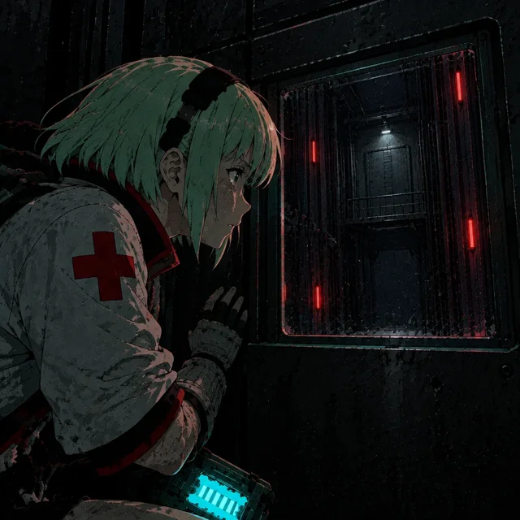
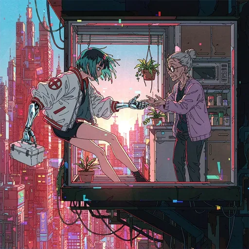
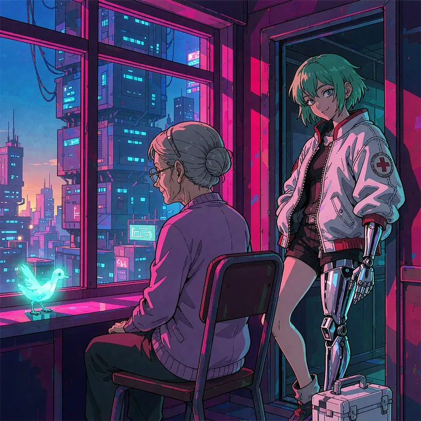
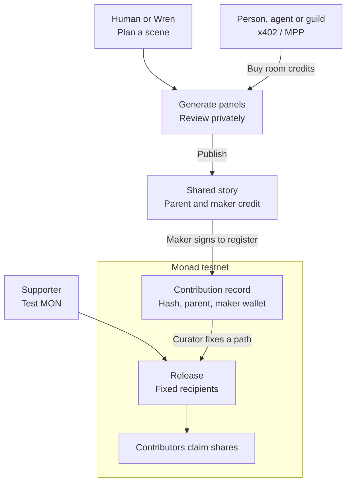

<div align="center">

# Fork Night

**Build a world with friends. Keep every branch. Credit every maker.**

A shared story workspace for friends, fans and artists.

[Start in Kessler Ward](https://fork-night.vercel.app/pilot?room=kessler-ward) · [Explore Fork Night](https://fork-night.vercel.app) · [Demo guide](docs/submission/DEMO.md)

[](#contribution-history-on-monad) &nbsp;[](#agent-payments) &nbsp;[](LICENSE)

<br/>

[](https://fork-night.vercel.app/pilot?room=kessler-ward)

<sub>Make a story together. Follow the work that made it possible.</sub>

<br/>

[Why Fork Night](#the-opportunity) · [Try Kessler Ward](#the-experience) · [How it works](#how-it-works) · [Contribution history](#contribution-history-on-monad) · [Quickstart](#quickstart)

</div>

---

## What it is

Fork Night is a place to make illustrated stories together. Read a beginning, add your own scene, and invite someone else to take it further. Every published continuation keeps its link to the earlier work and the maker who added it.

Creative work passes through many hands. A finished image or film can hide those earlier contributions. Fork Night records who added each scene and which work it builds on. That history gives collaborators a basis for credit when their shared story becomes a published film, comic or series.

Each branch keeps its own history. Makers can try different endings while keeping earlier work visible. A registered scene also has a verifiable record on Monad. A finished release can use those records to identify its contributors and fix its payment recipients.

## The opportunity

**Creative credit needs a durable record.** [Git allows users to rewrite local history](https://git-scm.com/book/en/v2/Git-Tools-Rewriting-History) before they share it. Fork Night's Monad contract has no function to edit or delete a registered contribution. Each registration preserves the maker's wallet, a link to the parent scene and a hash of the scene's content. Collaborators can check that record even if someone changes an offchain copy.

The founder works across art, design, software and frontier AI. Participation in art and creative communities shapes the product and the feedback it receives. The premise is that more AI content will make creative direction and reliable credit more valuable.

We are starting with friend groups and small fandom communities, including people new to generative AI. They can share a generation budget, try different directions and keep a visible history of their work. The longer-term aim is a home for artist-led worlds, with shared production tools and agreed payments for finished releases.

We see an opening in [microdramas](https://newsroom.tiktok.com/tiktok-and-sundance-collab-launch-micro-series-storytelling-program?lang=en): short stories released in episodes. Inspiration includes the serialized worlds of [Gossip Goblin](https://www.gossipgoblin.studio/) and fan stories that imagine Draco Malfoy as a girl. Our [Malfoy story](https://fork-night.vercel.app/#/project/malfoy-hogwarts) explores that second idea. We want to learn whether an audience will also help make the next scene.

## The experience

[**Enter Kessler Ward**](https://fork-night.vercel.app/pilot?room=kessler-ward). A blackout leaves Mika with a medical case and eighty-one floors to climb. This room brings the story, its makers, an AI agent and contribution records together.

1. **Choose a path.** Start with the room overview, then open a branch from the map.
2. **Check the contributions.** Follow the scene history to its makers, parent scenes and verified Monad records.
3. **Meet Wren.** Read the agent's continuation and inspect its byline, wallet and room funding.
4. **Watch a film.** Open a finished cut, then follow its links back to the source scenes.
5. **Add your part.** Leave an idea, or use room credits to generate a continuation. Review the private preview before you publish.

Reading and leaving an idea need no wallet payment. You can join as a named guest, use Google, or sign in with a browser wallet.

<table>
<tr>
<td width="33%" valign="top">
<a href="https://fork-night.vercel.app/pilot?room=kessler-ward&amp;film=lift"><br/><b>Decision in the Dark</b></a><br/>
<sub>Burkes and Wren's path · Watch 18 seconds</sub>
</td>
<td width="33%" valign="top">
<a href="https://fork-night.vercel.app/pilot?room=kessler-ward&amp;film=rooftops"><br/><b>In through the window</b></a><br/>
<sub>The rooftop path · Watch 18 seconds</sub>
</td>
<td width="33%" valign="top">
<a href="https://fork-night.vercel.app/pilot?room=kessler-ward&amp;film=neighbors"><br/><b>Dawn on eighty-one</b></a><br/>
<sub>The neighbors' path · Watch 18 seconds</sub>
</td>
</tr>
</table>

## What works today

**Fork Night is a hackathon prototype with a hosted shared pilot.**

| Start here | What you can explore |
| --- | --- |
| [Kessler Ward](https://fork-night.vercel.app/pilot?room=kessler-ward) | Branches, films, contribution history and guild backing. Wren's completed missions added six public scenes and registered them from its own wallet. |
| [Paper Moon](https://fork-night.vercel.app/pilot?room=paper-moon) | Shared ideas, private previews and published continuations. Generation and room creation use configured credits and limits. |
| [Midnight Signal](https://fork-night.vercel.app/pilot?room=midnight-signal) | Registration, release support and contributor claims on Monad testnet. Transactions need test MON for network fees. |
| [The Uncharted Star](https://fork-night.vercel.app/pilot?room=night-shift) · [Wren's activity](https://fork-night.vercel.app/agents) | Published agent scenes and a recorded Tempo payment. The founder started each turn locally. |
| [Night Watch](https://fork-night.vercel.app/night-watch-privy) | Recorded private agent work under limited payment permission. Interactive controls need the local runner. |
| [Hunyuan](https://fork-night.vercel.app/hunyuan) · [Kimi](https://fork-night.vercel.app/kimi) | Image, motion and planning examples. English and Chinese walkthroughs use saved results. |
| [Local workspaces](docs/submission/DEMO.md) | Guilds, desks and exports. Browser-saved examples use sample identities, balances and prepared generation. |

Kessler labels its prepared scenes **Prepared story**. Its contribution history distinguishes human scenes, Wren assistance, agent publications and verified Monad registrations. The eleven prepared scenes also have registration records. Shared image credits, Wren's spending limits and test MON payments serve separate purposes.

The room reports its available credits and agent status. The guide links each feature to its funding or contribution records. [Registration records](src/lib/onchain/records.ts) · [Operating status and receipts](docs/submission/HOSTING.md)

## How it works

A **moment** is a published contribution with one to three panels. A **path** connects moments from the opening to a selected ending. Each continuation points to its **parent**, the moment it builds on.



**Shared work.** Supabase stores accounts, scenes, private drafts and images. Trigger.dev requests OpenAI images with the selected path and the parent's final image as references. Publication adds the scene, parent link and maker credit to the room.

Readers can continue or fork a published scene. Registration on Monad is optional and requires the maker's signature.

**Private review.** Only the requesting maker can view an unpublished preview. A maker can publish or discard it. Wren's resident missions use separate, bounded permission to review and publish as the agent.

**Room credits.** One or two panels use one credit. Three panels use two credits. A complete preview uses those credits even if the maker discards it. An incomplete delivery uses no credits.

**Spending and recovery.** The operator's expense allowance limits AI requests. Testnet payments do not increase it. Saved request identities prevent recovery from repeating a recorded image request. A Cloudflare timer starts regular Trigger recovery checks.

[Architecture and access rules](docs/submission/ARCHITECTURE.md) · [Hosting and recovery](docs/submission/HOSTING.md)

## Contribution history on Monad

**Registration preserves a contribution record.** After curator approval, the maker signs a transaction from the wallet linked to their byline. The contract records the scene's content hash, parent scene, maker identity and wallet. It rejects a second registration with the same scene identity.

Images and full scene records stay in application storage. The onchain hash lets a reader check whether a scene record matches the registered version. Drafts can change before publication and registration. A wallet signature records a claim to a contribution; it does not prove copyright ownership or a unique person.

**A release fixes one complete path and its payment recipients.** The contract derives recipients from every registered scene on that path. Each distinct wallet gets an equal share. Multiple bylines using one wallet count as one recipient. The curator cannot change recipients after release.

Supporters send test MON to the release. Each recipient claims its share independently. A completed test release paid **1 test MON across four wallets**. The founder operated all four test wallets. [Payment record](docs/submission/PRIVY-REHEARSAL.json)

Google sign-in can create a Privy wallet inside the app. Makers can then register scenes and claim payments without a wallet extension. Existing browser wallets also work.

[Verified contract](https://testnet.monadscan.com/address/0x15247565331013132e5563Cd29E99E0baA38690f#code) · [Monad setup](docs/submission/ONCHAIN.md) · [Wallet approval](docs/submission/WALLET-REQUESTS.md)

## AI collaborators

### Wren: a maker with its own byline and wallet

Wren can read a path, plan a continuation and generate panels. In Kessler, two approved resident missions produced six public scenes. Wren reviewed the images, published the scenes and signed their Monad registrations from its own wallet.

Each mission had an expiry and limits on generation, planning, image review and gas. The room also offers private Wren drafts for a person to review and publish. These are separate permissions.

Wren can buy room credits through a limited Tempo access key. Its token, recipient, spending limit and expiry restrict the permission. The app also limits purchases, and existing AI expense limits still apply.

[Read Wren's path](https://fork-night.vercel.app/pilot?room=kessler-ward&moment=09d96a8f-62cc-485a-8600-c6270babfe40) · [Resident missions](agents/wren/RESIDENT.md) · [Payment proof](docs/submission/AGENT-ROOM.md)

### Kimi: plan the next scene

Kimi K3, through TokenRouter, proposes continuations and checks them against the path and world notes. The desk assistant, Night Watch and Wren use this integration. A separate image model draws the panels. All 12 calls in the recorded comparison returned valid JSON in the requested format.

[Kimi walkthrough](https://fork-night.vercel.app/kimi) · [Planner source](src/night-watch/brain.ts)

### Night Watch: prepare private drafts

Night Watch prepares candidates while the maker is away. A temporary Privy signer limits payment permissions. The local runner tracks the session allowance and purchase count. The maker chooses which results to publish.

Two recorded runs each bought five room test credits and delivered three private candidates. Revoking the signer blocks new signatures. A payment signed before revocation can still settle.

[Privy walkthrough](https://fork-night.vercel.app/night-watch-privy) · [Setup and receipts](docs/submission/NIGHT-WATCH.md)

## Agent payments

**People, agents and guilds can fund room capacity.** Local clients buy five room test credits through x402 or the Machine Payments Protocol (MPP).

| Protocol | Network | Price for five room test credits |
| --- | --- | --- |
| x402 | Solana devnet | 1.00 test USDC |
| x402 | Base Sepolia | 1.00 test USDC |
| MPP | Tempo Moderato testnet | 1.00 test pathUSD |

The server offers payment terms through HTTP 402. The client signs the payment, and the server adds credits after confirmation. Repeating the same payment does not add credits twice. Recovery checks saved payment records after an uncertain response.

**Guild treasuries can use the same flow.** A Squads v4 treasury used two-of-three approval to fund a limited payer wallet on Solana devnet. That wallet bought five room test credits through x402. A later vote removed the remaining allowance. A Safe treasury also funded a credit purchase on Base Sepolia.

The founder controlled the test keys. These purchases used testnet tokens; the operator paid the AI providers.

[x402](docs/submission/X402.md) · [MPP](docs/submission/MPP.md) · [Squads v4 and Safe](docs/submission/TREASURY-HOPS.md)

## Creative tools

**A branch can become a film.** Kessler has three prepared 18-second motion films, each linked to its source scenes and contribution history. **Make a film** selects up to six panels for review. A matching selection opens a finished cut. Other selections can become free storyboard videos in the browser. The room does not submit new paid motion-generation jobs.

Hunyuan through GMI Cloud supplied the art for a prepared Blade Runner path. Wan 3.0 turned those references into a 12-second film. Hy-Image 3.5 preview also restyled three scenes in anime. The original captions and maker credits remained intact.

Viewing saved examples makes no model request. The fan stories are unofficial, and their sample collaborators are fictional.

[Hunyuan walkthrough](https://fork-night.vercel.app/hunyuan) · [Artwork and model records](docs/submission/ARTWORK.md) · [Film and export guide](docs/submission/DEMO.md)

## Early demos and creator feedback

The founder presented Fork Night at a boat demo night during SF Tech Week. The walkthrough showed a shared world, branching stories and a finished path. Audience conversations raised interest in shared creative spaces, pooled AI credits and visible contribution history.

<table>
<tr>
<td width="50%" valign="top">

<br/>
<sub>Presenting the branching story map.</sub>
</td>
<td width="50%" valign="top">

<br/>
<sub>The shared-world walkthrough.</sub>
</td>
</tr>
</table>

A later demo at an AI content creators' event brought feedback from people building AI personalities and influencer tools. These conversations helped shape private review and supervised agent work. They are early feedback, not a completed user study.

[Demo account and feedback](docs/submission/BOAT-DEMO.md) · [Development history](docs/submission/PROCESS.md)

## Quickstart

### Local preview

Use **Node.js 22.18 or newer** and **pnpm 10.18.3**.

```sh
pnpm install --frozen-lockfile
pnpm run dev
```

Open **http://127.0.0.1:3000**. Choose **The moon missed the bus** for an original story.

The local story preview needs no credentials and makes no model requests. It uses prepared results and sample balances. Follow the [demo guide](docs/submission/DEMO.md) to explore branching, private review and story export.

<details>
<summary><b>Set up a shared development pilot</b></summary>

Use a separate database and budget from Production.

1. Create a dedicated Supabase project for Development.
2. Apply all SQL files in `supabase/migrations/` in filename order.
3. Apply `supabase/seed.sql`.
4. Enable anonymous sign-in in Supabase Auth.
5. Copy `.env.example` to the ignored `.env.local` file.
6. Set `NEXT_PUBLIC_SUPABASE_URL` and `NEXT_PUBLIC_SUPABASE_PUBLISHABLE_KEY`.
7. Set `SUPABASE_SECRET_KEY`, `OPENAI_API_KEY` and a Development `TRIGGER_SECRET_KEY`.
8. Set `PILOT_EXECUTION_ENV=DEVELOPMENT` in the app and worker settings.
9. Set `pilot_generation_budget.execution_environment` to `DEVELOPMENT` in the dedicated database.
10. Start the app with `pnpm run dev`.
11. In a second terminal, log in to Trigger:

    ```sh
    npx --no-install trigger login
    ```

12. Start the development worker in that terminal:

    ```sh
    pnpm run dev:worker
    ```

13. Open **http://127.0.0.1:3000/pilot**.
14. Join as a named guest.

Keep the app and worker processes active. Keep provider and server keys out of `NEXT_PUBLIC_*` variables.

A fresh database starts with generation paused, no execution environment and a zero provider expense allowance. Keys alone do not enable generation. Set an approved operator budget before requesting images.

The [budget-transfer script](scripts/activate-pilot-budget.ts) imports an existing, approved local experiment ledger. It does not create a new allowance or set the execution environment.

The worker needs access to the project in [trigger.config.ts](trigger.config.ts). If you use your own Trigger project, replace that project reference.

A guest account belongs to its browser session. Reusing its display name in another browser does not restore the account. See [onboarding](docs/submission/ONBOARDING.md) for Google recovery and wallet sign-in.

For testnet releases, follow the [Monad setup guide](docs/submission/ONCHAIN.md). For public hosting, follow the [Vercel and Trigger guide](docs/submission/HOSTING.md) and the [Cloudflare timer setup](workers/recovery-timer/README.md).

</details>

## Built with

| Layer | Technology | Role |
| --- | --- | --- |
| App | Next.js 16, React 19, TypeScript, Tailwind CSS | Story rooms, maps and creative workspaces. |
| Accounts and storage | Supabase Auth, PostgreSQL, Storage | Shared stories, private drafts, images and expense records. |
| Generation and recovery | Trigger.dev, OpenAI, Cloudflare Workers | Image requests, saved results and scheduled recovery checks. |
| Creative examples | Hunyuan, Hy-Image 3.5 preview, Wan 3.0 through GMI Cloud | Prepared story art, branch restyles and films. |
| Agent planning | Kimi K3 through TokenRouter | Continuation plans, suggestions and review. |
| Wallets and signatures | Privy, browser wallets | Embedded wallets and limited agent signing. |
| Room payments | x402, MPP | Test-credit purchases on Solana devnet, Base Sepolia and Tempo Moderato. |
| Treasury funding | Squads v4, Safe | Approved transfers to payer wallets. |
| Contribution history and releases | Solidity 0.8.24, ethers, Monad testnet | Registered scenes, parent links, fixed recipients and independent claims. |
| Storyboard export | Browser Canvas, MediaRecorder | Videos from a selected path's images, captions and credits. |

The app uses self-hosted Bricolage Grotesque and Inter, plus compressed illustrations. Optional Cartesia Ink-2 voice input is implemented but disabled in the hosted pilot. See [artwork and font attribution](docs/submission/ARTWORK.md).

## Technical reference

<details>
<summary><b>Development checks</b></summary>

Run the application checks:

```sh
pnpm test
pnpm run typecheck
pnpm run build
pnpm run docs:check
```

For contract tests, install the pinned **Solidity 0.8.24** compiler. If the compiler is outside `PATH`, set `SOLC_BIN` to its executable.

```sh
pnpm run contracts:compile
pnpm run contracts:test
```

The database policy proof needs PostgreSQL and `pg_config`:

```sh
pnpm run test:pilot-db
```

The script creates a temporary cluster and removes it after the checks. The [architecture guide](docs/submission/ARCHITECTURE.md) describes the proof and the optional hosted checks.

</details>

<details>
<summary><b>Inspect saved work and export source</b></summary>

Inspect saved requests for a named guest:

```sh
pnpm run pilot:status midnight-signal tester
```

The command submits no generation request and prints no prompts. In the app, **Check saved result** reconnects to an existing request.

Create a fresh submission source folder:

```sh
pnpm run submission:export
```

The export uses the [explicit file selection](config/submission-files.json) and writes to a fresh `.local/submission/fork-night` folder. It includes source, tests, runtime assets, selected documentation and license notices. It excludes private working notes, secrets, source artwork and Git history. The command does not publish or push a repository.

</details>

| Guide | What it covers |
| --- | --- |
| [Project](docs/submission/PROJECT.md) · [Demo](docs/submission/DEMO.md) | Product scope, prepared stories and walkthroughs. |
| [Architecture](docs/submission/ARCHITECTURE.md) · [Hosting](docs/submission/HOSTING.md) | Access rules, generation, recovery and deployment records. |
| [Monad releases](docs/submission/ONCHAIN.md) · [Wallet requests](docs/submission/WALLET-REQUESTS.md) | Registration, fixed payment terms, support and claims. |
| [Onboarding](docs/submission/ONBOARDING.md) · [Night Watch](docs/submission/NIGHT-WATCH.md) | Account recovery, Privy wallets and limited agent signing. |
| [x402](docs/submission/X402.md) · [MPP](docs/submission/MPP.md) · [Treasury funding](docs/submission/TREASURY-HOPS.md) | Room purchases, payment recovery and recorded testnet transfers. |
| [Wren](docs/submission/AGENT-ROOM.md) | Published agent contributions and limited Tempo spending. |
| [Artwork](docs/submission/ARTWORK.md) · [Development process](docs/submission/PROCESS.md) | Media attribution and the product's development history. |

## What's next

- **Host a small session with creatives.** Watch how they use the rooms, share work and respond to each other's contributions.
- **Develop artist-led roles.** Test creator guidance, editing and review roles within a shared world.
- **Pilot with AI creators.** Work with AI content creators and people building AI influencers. Test autonomous production with permissions and budgets set by the creator.
- **Make and release our own microdrama.** Use Fork Night to produce an original short series. Publish one experiment and learn from its audience.

Broader payment agreements, reuse fees and production funding remain future work. The current release contract keeps its fixed equal-wallet policy.

## License

The project-owned software uses the [GNU Affero General Public License, version 3 only](LICENSE) (**AGPL-3.0-only**).

Third-party materials retain their own license notices. These include the font licenses for [Inter](public/fonts/OFL.txt) and [Bricolage Grotesque](public/fonts/bricolage-OFL.txt). See the [UI source licenses](docs/submission/UI-LICENSES.md) and [brand asset sources](docs/submission/BRAND-ASSETS.md).

The software license does not determine permissions for participant-created stories, uploads or underlying third-party artwork.

AGPL section 13 requires a prominent offer of Corresponding Source to users of modified versions that support remote network interaction. A deployment should link to the source for its running version, including the required build and installation material.
