# Fork Night: Round 4 visual exploration

These **14 selected static concepts** compare Fork Night's baseline, eight named variations and the combined **Made by the Room** direction. This is the Round 4 gallery from the early exploration stage, preserved here as part of [the project's development process](../../PROCESS.md).

All depicted people, artwork, event photography, prices, counts and receipts are generated illustrative material. The scenes do not document the boat demo. The economic arrangements shown here were proposals at this stage.

## Compare the directions

| Direction | Question explored | Screens |
| --- | --- | --- |
| Baseline | How does someone choose a fork, bound spending and review a result? | [Story wall](01-baseline-public-story-wall.webp), [quote](02-baseline-hold-and-generation-cap.webp), [review](03-baseline-preview-publish-or-discard.webp) |
| Hand-Made Forks | How could a physical drawing become a priced contribution? | [Paper to panel](04-hand-made-forks-paper-to-panel.webp), [maker pricing](05-hand-made-forks-maker-sets-price.webp) |
| Built On You | How could attribution and personal thanks become part of publishing? | [Thank-you](06-built-on-you-public-thank-you.webp), [room credits](07-built-on-you-room-credits.webp) |
| Canon Call | How could checked-in participants choose a storyline? | [Ballot](08-canon-call-door-pass-vote.webp) |
| Heaviest Path | How could a room surface branches attracting more builders? | [Path ranking](09-heaviest-path-most-built-on.webp) |
| Matched Night | How could sponsor funding support makers? | [Sponsor allocation](10-matched-night-sponsor-pool.webp) |
| Guest Artists | How could a specific artist's licensed work enter a story? | [Asset shelf](11-guest-artists-priced-art-shelf.webp) |
| Crossroads | How could participants fund the next scene together? | [Funded beat](12-crossroads-fund-and-generate-live.webp) |
| Open Feeds | How could people choose a discovery rule and its curator? | [Feeds and fees](13-open-feeds-curator-ranking-and-fee.webp) |
| Made by the Room | How could making, continuation, credit and payment form one experience? | [Combined concept](14-made-by-the-room-combined.webp) |

## The selected screens

### 01. Baseline: public story wall

The selected ancestry and fork point appear beside the illustrated story.

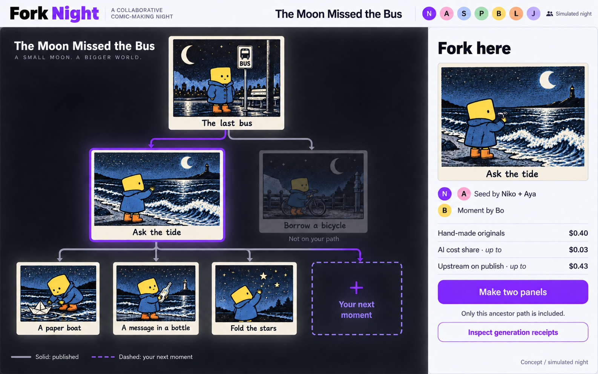

### 02. Baseline: capped quote

The proposed quote separates maker prices, remaining AI cost recovery and a maximum for new generation.

[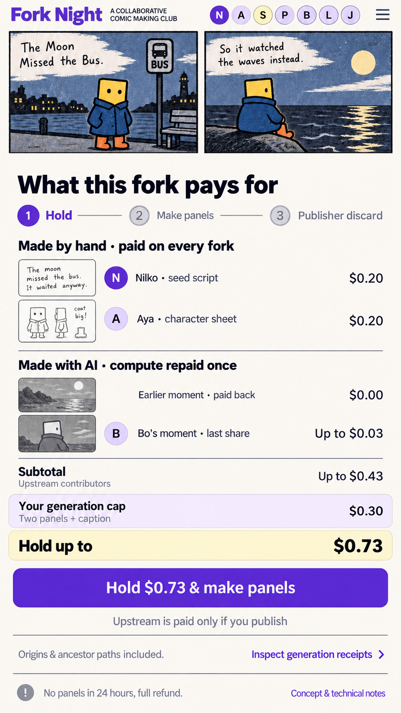](02-baseline-hold-and-generation-cap.webp)

### 03. Baseline: preview, publish or discard

The proposed review step shows the delivered result and how publishing or discarding affects the held amount.

[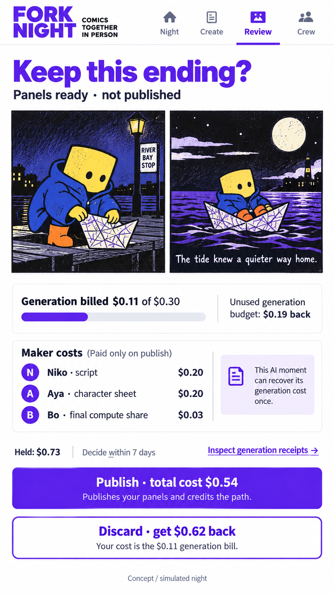](03-baseline-preview-publish-or-discard.webp)

### 04. Hand-Made Forks: paper to panel

A physical drawing becomes the opening panel, with an AI continuation reviewed beside it.

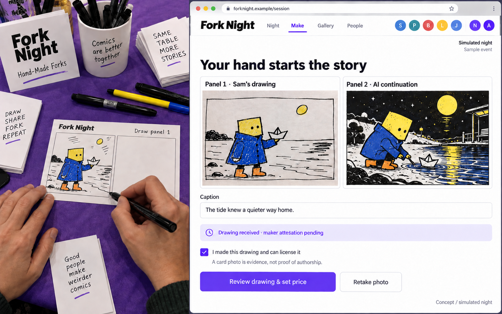

### 05. Hand-Made Forks: maker pricing

A maker proposes a price for reuse of a handmade panel. The example allows for no later forks and no earnings.

[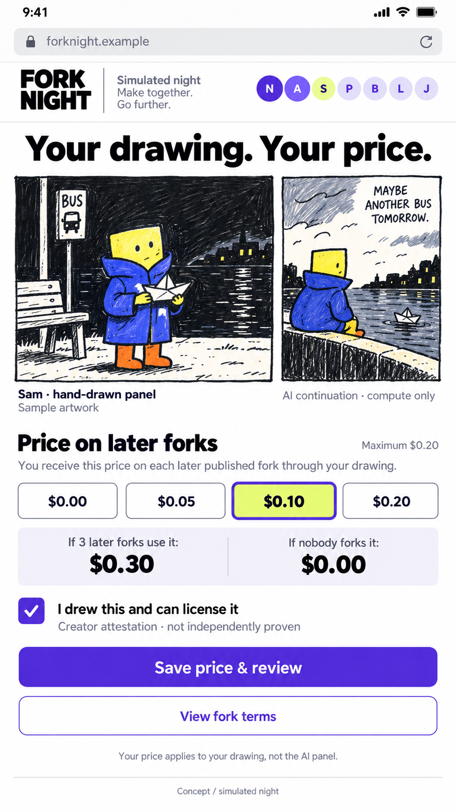](05-hand-made-forks-maker-sets-price.webp)

### 06. Built On You: personal thanks

Publishing combines an explicit work credit with a personal thank-you.

[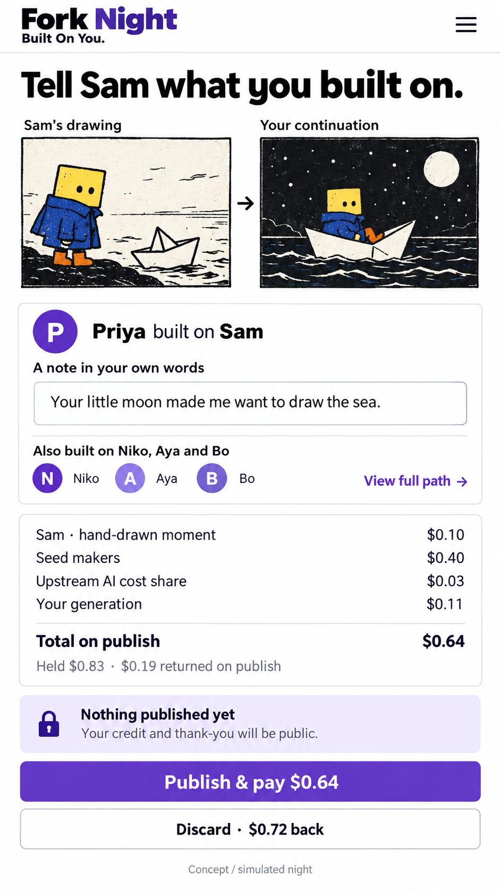](06-built-on-you-public-thank-you.webp)

### 07. Built On You: room credits

A projected credits roll celebrates the people and work behind the room's stories.

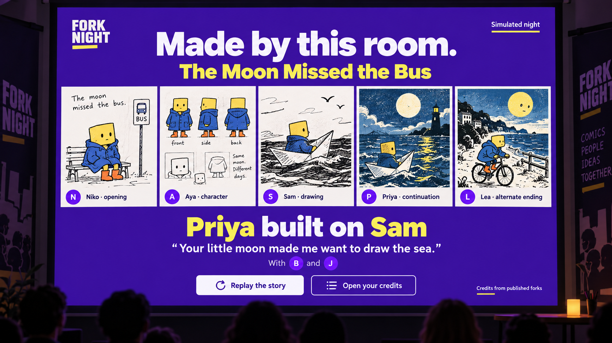

### 08. Canon Call: participant vote

The proposal gives checked-in participants one vote, disables self-voting and offers no cash prize. This screen does not establish resistance to collusion or false identities.

[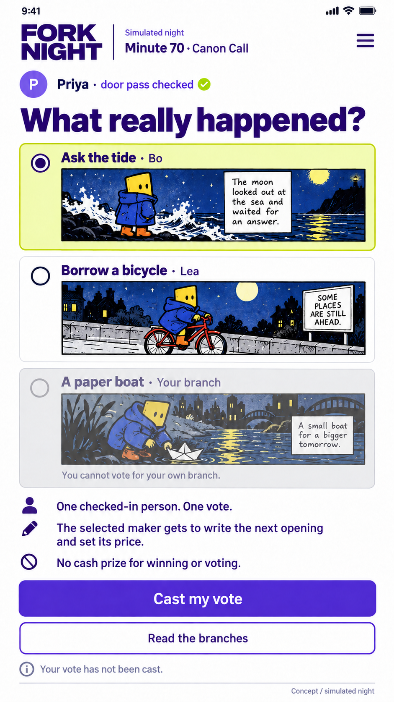](08-canon-call-door-pass-vote.webp)

### 09. Heaviest Path: branch discovery

The proposal surfaces branches by distinct builders beneath them. It is an exploration of discovery, rather than an implemented contribution-value formula.

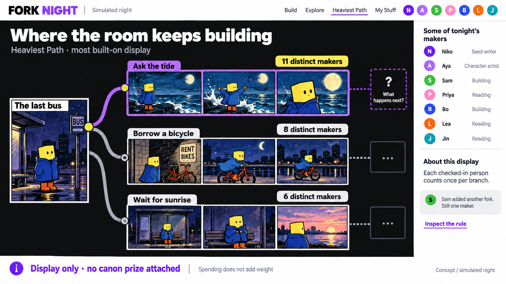

### 10. Matched Night: sponsor pool

A simulated sponsor pool appears separately from maker sales.

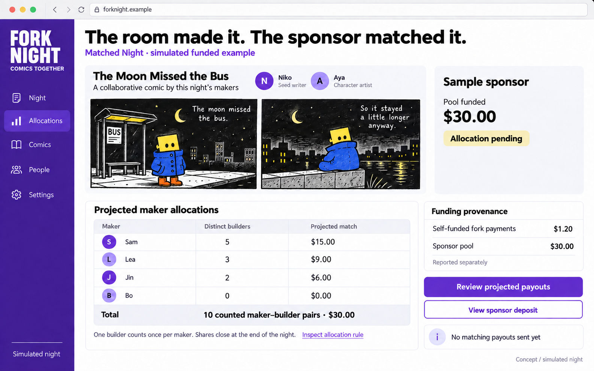

### 11. Guest Artists: specific licensed work

An asset shelf offers particular pieces under stated terms. The fee attaches to a work, without asserting ownership of an artist's style.

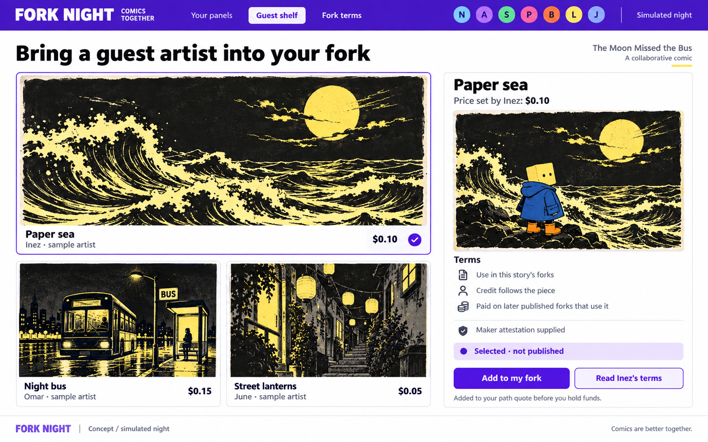

### 12. Crossroads: fund a beat together

Participants fund a selected story beat and wait for generation. This proposal gives backers no revenue share.

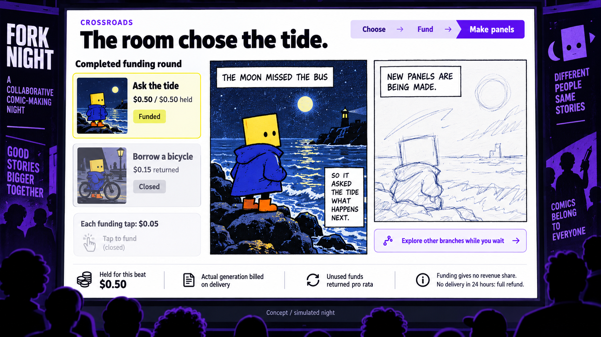

### 13. Open Feeds: choose a ranking

Participants compare discovery rules. The proposed curator fee is disclosed alongside a no-fee alternative.

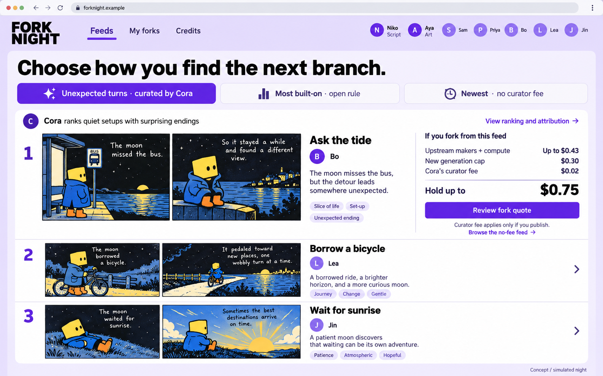

### 14. Made by the Room: combined experience

The concept joins drawing, public continuations, personal thanks and a small maker payment.

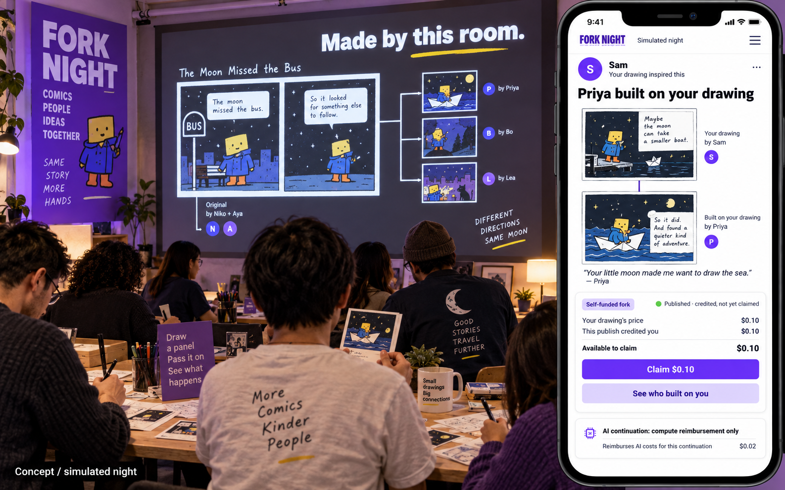

## Preservation and interpretation

The images are lossless WebP copies at their original dimensions. Their decoded pixels match the selected PNG revisions. [The selection record](selection.json) lists dimensions, revision numbers and source/output hashes without local machine paths.

The financial examples use illustrative rounded amounts. Some generated text has minor imperfections; these screens document product exploration.
